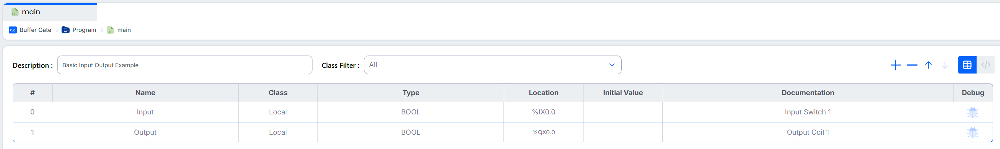

# 01 Buffer Gate

## Diagram

No overall process diagram was supplied for this project. The available captures are the rung and variable views in the `Screenshots` folder; neither describes a wider process.

## Variables

| Variable | Type | Address | Role in the pill-packaging example |
| --- | --- | --- | --- |
| `Input` | `BOOL` | `%IX0.0` | Generic digital input. The variable capture documents it as `Input Switch 1`; no particular packaging sensor or signal is identified. |
| `Output` | `BOOL` | `%QX0.0` | Generic digital output. The capture documents it as `Output Coil 1`; no connected load or machine function is identified. |

The project schedules `main` as a cyclic task with a 20 ms interval. No initial values are specified in the declarations, and the variable capture's initial-value cells are blank.

## Rungs

### Rung 1 - Main Rung

This is a direct input-to-output rung: `Output = Input`. Although the project is named Buffer Gate, its source and variable capture do not define a buffer sensor, actuator, or pill-packaging operation. The description below therefore stays with the declared signals.

**Power-flow sequence**

1. On each PLC scan, logical power is evaluated from the left rail through the rung toward the right rail.
2. The `Input` contact is a standard, non-negated (normally open) ladder contact. It conducts when the BOOL value of `Input` is `TRUE` and is open when `Input` is `FALSE`.
3. When the contact conducts, the path reaches the standard `Output` coil. The coil is set `TRUE`, so digital output `%QX0.0` is energized.
4. When `Input` is `FALSE`, the contact interrupts the only path. The coil is set `FALSE`, and `%QX0.0` is de-energized.
5. The rung has no branch, latch, or timer, so the output follows the input as the rung is reevaluated on each cyclic scan.

| `Input` | Contact | `Output` / `%QX0.0` |
| --- | --- | --- |
| `FALSE` | Open | `FALSE` |
| `TRUE` | Conducts | `TRUE` |