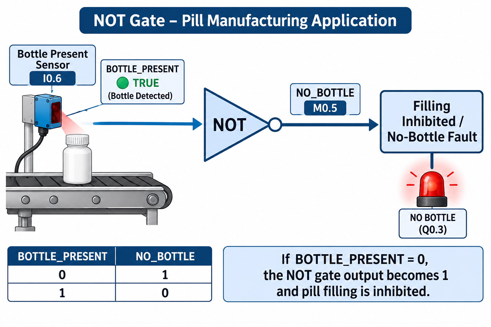
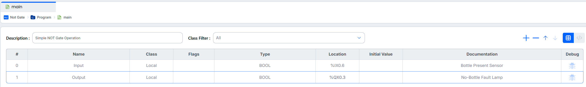

# 02 NOT Gate

## Diagram

The intended pill-packaging example treats the sensor as `Bottle Present`: when no bottle is detected, the NOT operation raises a no-bottle fault indication. The diagram labels an intermediate `NO_BOTTLE` bit at `%M0.5` and says filling is inhibited. The ladder program in this project does not declare or use that memory bit; its rung drives the physical output `%QX0.3` directly. Therefore, the implemented rung controls the fault lamp only. It does not, by itself, inhibit a filling actuator. A separate permissive or interlock in the filling-control logic would be needed to prevent filling.

## Variables

| Variable | Type | Address | Role in the pill-packaging example |
| --- | --- | --- | --- |
| `Input` | `BOOL` | `%IX0.6` | Digital input from the bottle-present sensor. `TRUE` means the sensor reports a bottle present. |
| `Output` | `BOOL` | `%QX0.3` | Digital output for the no-bottle fault lamp. The rung turns it on when `Input` is `FALSE`. |

The project schedules `main` as a cyclic task with a 20 ms interval. No initial values are specified for these variables in the program declaration.

## Rungs

### Rung 1 — Main Rung

This rung implements a logical NOT: `Output = NOT Input`. It has one series path from the left power rail to the right power rail, with a negated (normally closed) contact named `Input` followed by a standard output coil named `Output`.

**Power-flow sequence**

1. At each PLC scan, the rung is evaluated from the left rail toward the right rail.
2. The negated `Input` contact passes logical power when `Input` is `FALSE`. In the packaging example, this is the no-bottle condition.
3. If the contact passes power, the connected path reaches the `Output` coil. The coil is set `TRUE`, so output `%QX0.3` energizes the no-bottle fault lamp.
4. When `Input` is `TRUE`, indicating a bottle is present, the negated contact opens. Power flow stops at that contact, the coil is not energized, and `%QX0.3` is set `FALSE`.
5. The next cyclic scan reevaluates the contact and updates the coil from the current input state; the rung contains no latch or timer, so the output follows the input's inverse state.

| `Input` (bottle present) | Negated contact | `Output` / `%QX0.3` | Packaging interpretation |
| --- | --- | --- | --- |
| `FALSE` | Conducts | `TRUE` | No-bottle fault lamp on |
| `TRUE` | Open | `FALSE` | Bottle detected; fault lamp off |

This is an instructional logic example, not a safety-rated function. The fault-lamp output should not be treated as proof that filling is inhibited; verify that a separate, appropriately designed control condition blocks the filling actuator.