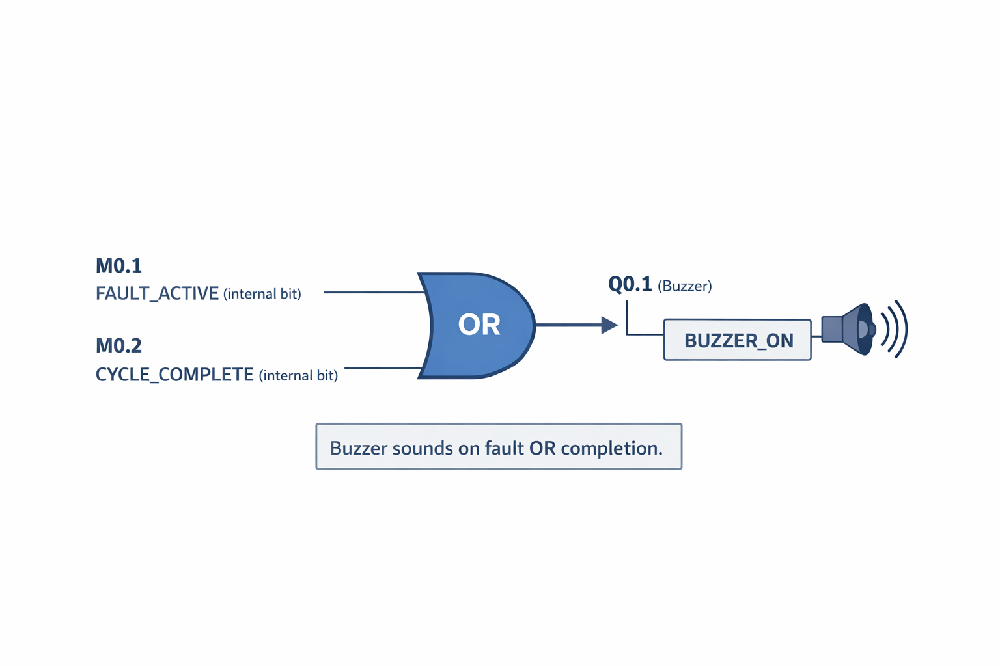
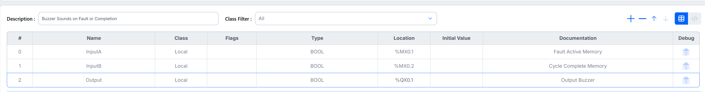

# 03 OR Gate

## Diagram

The pill-packaging example combines a fault-active flag and a cycle-complete flag. The diagram and variable capture identify them as internal memory bits at `%MX0.1` and `%MX0.2`; either condition is intended to sound the buzzer at `%QX0.1`. The ladder source names these variables `InputA` and `InputB`, respectively.

## Variables

| Variable | Type | Address | Role in the pill-packaging example |
| --- | --- | --- | --- |
| `InputA` | `BOOL` | `%MX0.1` | Internal memory flag documented as `Fault Active Memory`; the diagram labels it `FAULT_ACTIVE`. |
| `InputB` | `BOOL` | `%MX0.2` | Internal memory flag documented as `Cycle Complete Memory`; the diagram labels it `CYCLE_COMPLETE`. |
| `Output` | `BOOL` | `%QX0.1` | Digital output for the buzzer. The source comment and variable capture identify it as `Output Buzzer`. |

The project schedules `main` as a cyclic task with a 20 ms interval. No initial values are specified in the declarations, and the variable capture's initial-value cells are blank.

## Rungs

### Rung 1 - Main Rung

This rung implements an OR operation: `Output = InputA OR InputB`. Two standard, non-negated contacts form parallel paths between the rails, and the paths join before the buzzer coil.

**Power-flow sequence**

1. On each PLC scan, power from the left rail splits into an upper path through `InputA` and a lower path through `InputB`.
2. Each contact conducts only when its BOOL value is `TRUE`. Because the branches are in parallel, either conducting path is sufficient; both may conduct at the same time.
3. If `InputA` or `InputB` is `TRUE`, power reaches the `Output` coil. The coil is set `TRUE`, energizing buzzer output `%QX0.1`.
4. If both flags are `FALSE`, both contacts are open. No branch reaches the coil, so `Output` is set `FALSE` and the buzzer output is de-energized.
5. There is no latch or timer. The buzzer output is recalculated from the two memory-bit values on every scan; this rung reads those flags rather than creating their fault or cycle-complete conditions.

| `InputA` (fault) | `InputB` (cycle complete) | Conducting path | `Output` / `%QX0.1` |
| --- | --- | --- | --- |
| `FALSE` | `FALSE` | None | `FALSE` |
| `FALSE` | `TRUE` | `InputB` branch | `TRUE` |
| `TRUE` | `FALSE` | `InputA` branch | `TRUE` |
| `TRUE` | `TRUE` | Both branches | `TRUE` |