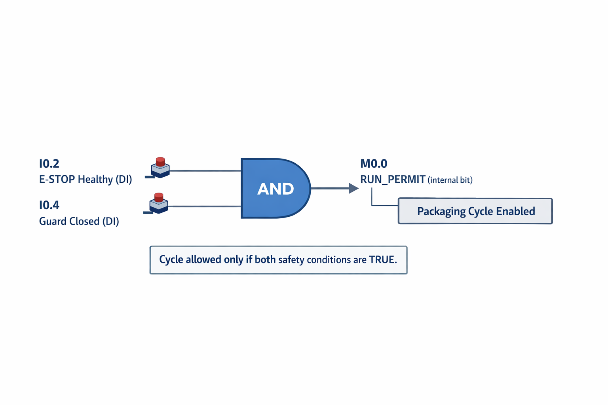
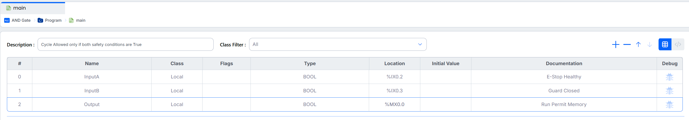

# 04 AND Gate

## Diagram

The pill-packaging diagram labels the conditions as E-stop healthy and guard closed, and the result as an internal run-permit bit. There is an address mismatch in the diagram: it labels Guard Closed as `I0.4`, but the source declaration and variable capture both assign `InputB` to `%IX0.3`. This README follows the program declaration. The diagram's E-stop address `%IX0.2` and run-permit address `%MX0.0` agree with the source and capture.

## Variables

| Variable | Type | Address | Role in the pill-packaging example |
| --- | --- | --- | --- |
| `InputA` | `BOOL` | `%IX0.2` | Digital input documented as `E-Stop Healthy`. |
| `InputB` | `BOOL` | `%IX0.3` | Digital input documented as `Guard Closed`; the diagram's `I0.4` label conflicts with this declared address. |
| `Output` | `BOOL` | `%MX0.0` | Internal memory bit documented as `Run Permit Memory`; it is not a physical output in this program. |

The project schedules `main` as a cyclic task with a 20 ms interval. No initial values are specified in the declarations, and the variable capture's initial-value cells are blank.

## Rungs

### Rung 1 - Main Rung

This rung implements an AND operation: `Output = InputA AND InputB`. Both contacts are standard, non-negated (normally open) contacts in one series path, so both BOOL values must be `TRUE` for the path to reach the coil.

**Power-flow sequence**

1. On each PLC scan, logical power travels from the left rail through `InputA`, then `InputB`, toward the `Output` coil.
2. The `InputA` contact conducts when the E-stop-healthy signal is `TRUE`. If it is `FALSE`, the path stops at the first contact.
3. If `InputA` conducts, the `InputB` contact also must conduct, which requires the guard-closed signal to be `TRUE`.
4. Only when both contacts conduct does the standard coil set `Output` to `TRUE`, setting internal bit `%MX0.0`. If either contact is open, the coil is set `FALSE`.
5. The coil is reevaluated each scan; the rung has no latch or timer. The project shows only this internal run-permit bit, not a physical actuator controlled by it.

| `InputA` (E-stop healthy) | `InputB` (guard closed) | `Output` / `%MX0.0` |
| --- | --- | --- |
| `FALSE` | `FALSE` | `FALSE` |
| `FALSE` | `TRUE` | `FALSE` |
| `TRUE` | `FALSE` | `FALSE` |
| `TRUE` | `TRUE` | `TRUE` |

These labels describe the intended logical conditions, not a safety-rated emergency-stop or guard function. This single standard-logic rung does not establish safety integrity or show how the internal permit is used elsewhere.