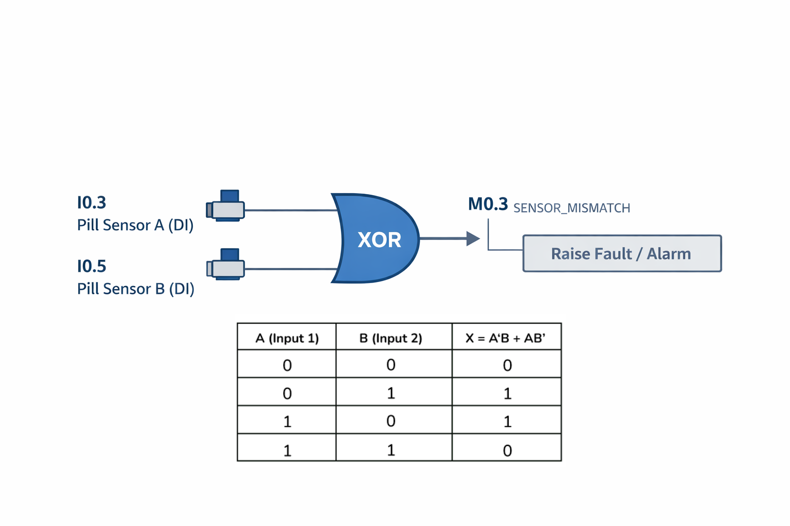
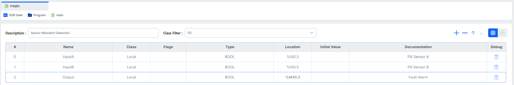

# 05 XOR Gate

## Diagram

The pill-packaging example compares two pill-sensor signals. The diagram labels `%IX0.3` as Pill Sensor A and `%IX0.5` as Pill Sensor B, and describes a mismatch when exactly one sensor is active. These input addresses agree with the program. The result is mapped to internal memory bit `%MX0.3`; although the diagram says to raise a fault or alarm, the program does not declare a physical alarm output.

## Variables

| Variable | Type | Address | Role in the pill-packaging example |
| --- | --- | --- | --- |
| `InputA` | `BOOL` | `%IX0.3` | Digital input documented as `Pill Sensor A`. |
| `InputB` | `BOOL` | `%IX0.5` | Digital input documented as `Pill Sensor B`. |
| `Output` | `BOOL` | `%MX0.3` | Internal memory bit documented as `Fault Alarm`; the diagram labels it `SENSOR_MISMATCH`. It is not a physical alarm output in this program. |

The project schedules `main` as a cyclic task with a 20 ms interval. No initial values are specified in the declarations, and the variable capture's initial-value cells are blank.

## Rungs

### Rung 1 - Main Rung

The rung implements exclusive OR: `Output = (InputA AND NOT InputB) OR (NOT InputA AND InputB)`. Two parallel paths feed the same standard output coil. The upper path has a standard `InputA` contact followed by a negated `InputB` contact; the lower path has a negated `InputA` contact followed by a standard `InputB` contact.

**Power-flow sequence**

1. On each PLC scan, power from the left rail splits between the upper and lower branches. The branch outputs rejoin before the `Output` coil.
2. In the upper branch, `InputA` must be `TRUE` for its standard contact to conduct, and `InputB` must be `FALSE` for its negated contact to conduct. This branch passes power only for `InputA = TRUE`, `InputB = FALSE`.
3. In the lower branch, the negated `InputA` contact conducts when `InputA` is `FALSE`, and the standard `InputB` contact conducts when `InputB` is `TRUE`. This branch passes power only for `InputA = FALSE`, `InputB = TRUE`.
4. If exactly one pill-sensor input is `TRUE`, one branch conducts and the coil sets internal bit `%MX0.3` to `TRUE`. If both inputs have the same value, neither complete branch conducts and the coil sets the bit to `FALSE`.
5. The output is recalculated on each scan; there is no latch or timer. Downstream fault handling or a physical alarm is not shown in this project.

| `InputA` | `InputB` | Conducting branch | `Output` / `%MX0.3` |
| --- | --- | --- | --- |
| `FALSE` | `FALSE` | None | `FALSE` |
| `FALSE` | `TRUE` | Lower | `TRUE` |
| `TRUE` | `FALSE` | Upper | `TRUE` |
| `TRUE` | `TRUE` | None | `FALSE` |