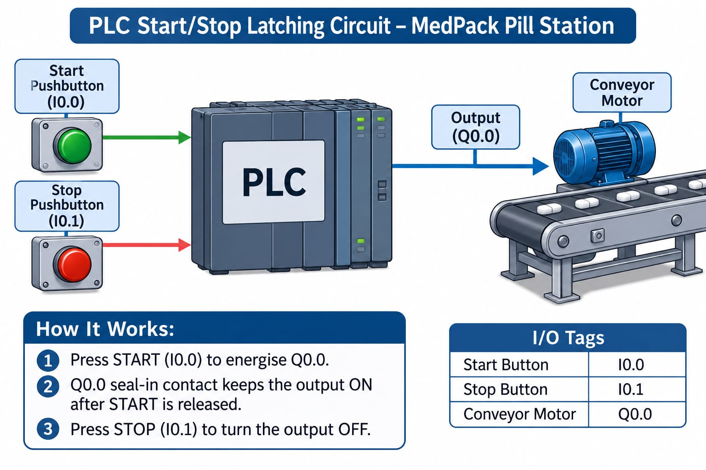
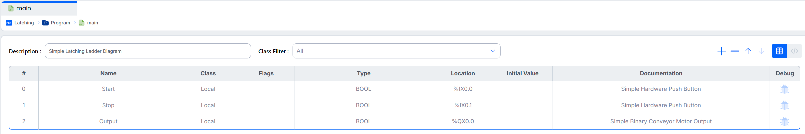

# 06 Latching - Conveyor Belt

## Diagram

The process diagram identifies a start pushbutton at `%IX0.0`, a stop pushbutton at `%IX0.1`, and a conveyor-motor output at `%QX0.0`. These addresses agree with the program and variable capture. The diagram says pressing STOP turns the output off; in the ladder source, however, the `Stop` contact is negated and therefore opens when the BOOL `Stop` value is `TRUE`. The project does not specify the pushbutton wiring or signal polarity, so the pictured behavior assumes `Stop` becomes `TRUE` when pressed.

## Variables

| Variable | Type | Address | Role in the pill-packaging example |
| --- | --- | --- | --- |
| `Start` | `BOOL` | `%IX0.0` | Digital input for the start pushbutton, documented as a simple hardware push button. |
| `Stop` | `BOOL` | `%IX0.1` | Digital input for the stop pushbutton, documented as a simple hardware push button. Its logical polarity is not specified; the rung uses a negated contact. |
| `Output` | `BOOL` | `%QX0.0` | Digital output documented as a simple binary conveyor-motor output; the process diagram labels it as the conveyor motor. |

The project schedules `main` as a cyclic task with a 20 ms interval. No initial values are specified in the declarations, and the variable capture's initial-value cells are blank.

## Rungs

### Rung 1 - Main Rung

This is a seal-in (latching) rung. `Start` and a standard `Output` feedback contact are in parallel; the joined path passes through the negated `Stop` contact before reaching the standard `Output` coil. The feedback contact holds the output on after the start signal is released.

**Power-flow sequence**

1. On each PLC scan, power from the left rail splits into two parallel paths. The upper path uses the standard, non-negated `Start` contact; the lower path uses a standard, non-negated contact addressed to `Output` as the seal-in path.
2. From the off state, a `TRUE` `Start` value conducts through the upper path. The parallel branches then join, and the negated `Stop` contact passes power only while `Stop` is `FALSE`.
3. If the joined path reaches the standard `Output` coil, the coil sets `%QX0.0` to `TRUE`. The `Output` feedback contact then conducts on the next evaluation, providing a path around `Start`.
4. When `Start` returns to `FALSE`, the energized `Output` contact maintains the path, provided `Stop` remains `FALSE`. The output therefore stays on after the momentary start command is released.
5. When `Stop` is `TRUE`, its negated contact opens. Because it is in series after both parallel branches, it interrupts both paths; the coil sets `%QX0.0` to `FALSE` and the seal-in contact opens. Once `Stop` returns to `FALSE`, the output remains off until `Start` is activated again.
6. The standard coil is recalculated on every 20 ms cyclic scan. No timer or set/reset coil is used; retention comes from the `Output` contact in the parallel branch.

| `Start` | `Stop` | Previous `Output` | Rung result |
| --- | --- | --- | --- |
| `FALSE` | `FALSE` | `FALSE` | Output remains `FALSE`; no path conducts. |
| `TRUE` | `FALSE` | Either | Output becomes `TRUE` through the Start branch. |
| `FALSE` | `FALSE` | `TRUE` | Output remains `TRUE` through the seal-in branch. |
| Either | `TRUE` | Either | Output becomes `FALSE`; the negated Stop contact opens. |

The logical description above follows the declared BOOL values. Confirm the real input wiring and polarity before applying the diagram's pushbutton interpretation to hardware.