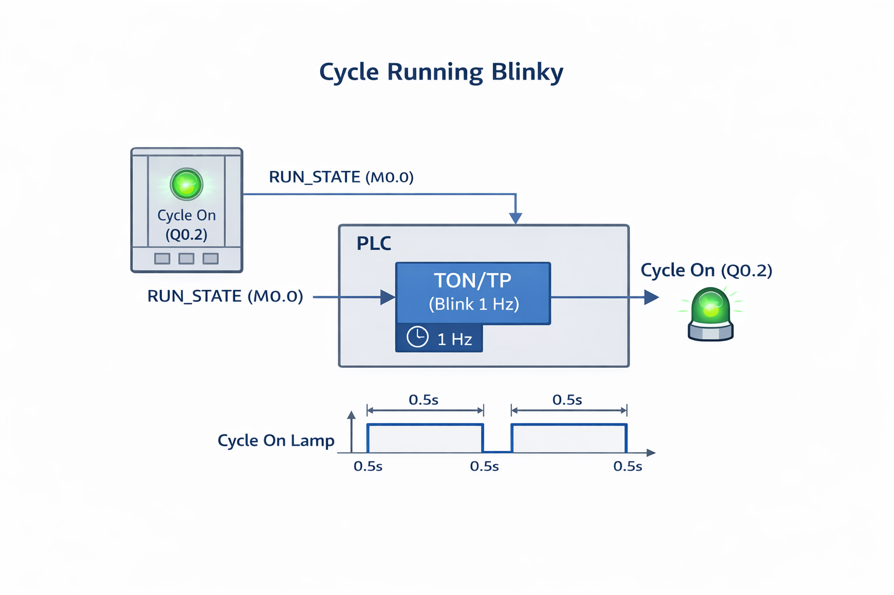
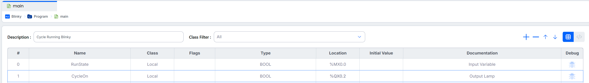

# 07 Blinky - Heartbeat

## Process Diagram

The diagram above is labelled **Cycle Running Blinky** and shows a `RunState` signal operating a 1 Hz indicator. It does not match this folder's ladder source, rung screenshot, or variable screenshot: those describe an error buzzer driven by `FaultActive`. The implementation documented below follows `pous/programs/main.ld`; the process diagram appears to belong with the cycle-running example. In the implemented project, `%MX0.0` is a memory bit, not a physical input address, so an input device or other logic must set `FaultActive`.

## Variables

| Variable | Type | Address | Role |
| --- | --- | --- | --- |
| `FaultActive` | `BOOL` | `%MX0.0` | Memory bit representing an active packaging-line fault. The source comment calls it an input variable, but its address is in memory. |
| `Buzzer` | `BOOL` | `%QX0.2` | Digital output for the audible fault warning. |
| `TON0` | `TON` | - | On-delay timer used to set the buzzer pulse interval. |
| `TOF0` | `TOF` | - | Off-delay timer used to hold each buzzer pulse. |

No initial values are declared. `project.json` schedules `main` on `task0`, a cyclic task with a 20 ms interval and priority 1.

## Rungs

### Rung 1 - Main Rung

The source has one path from the left rail to the right rail. A normally open `FaultActive` contact is followed by a negated (normally closed) `Buzzer` contact, `TON0`, `TOF0`, and the `Buzzer` output coil. The timer presets are `TON0.PT = T#0.8s` and `TOF0.PT = T#0.2s`.

**Power-flow sequence**

1. On each scan, `FaultActive` passes power only while the memory bit is `TRUE`. The negated `Buzzer` contact then passes power while the output variable is `FALSE`; when the buzzer is on, this feedback contact opens and interrupts the timer input path.
2. With the fault active and the buzzer off, `TON0.IN` is energized. After the input has remained continuously true for 0.8 s, `TON0.Q` becomes true and energizes `TOF0.IN`.
3. `TOF0.Q` energizes the `Buzzer` coil. The output at `%QX0.2` turns on, and on the next scan the negated `Buzzer` contact opens. This drops the TON input and starts the TOF off-delay.
4. `TOF0.Q` stays true for 0.2 s after its input turns false, so the buzzer remains on for that interval. When the TOF expires, the coil turns off, the feedback contact closes, and another 0.8 s timing interval begins if `FaultActive` is still true.
5. With a continuously active fault, the intended pattern is therefore approximately 0.2 s on and 0.8 s off. Timing is scan-based, so actual transitions are quantized by the 20 ms cyclic task. If `FaultActive` clears during a pulse, the TOF can still hold the buzzer on for up to its remaining 0.2 s off-delay.

This rung drives only the buzzer. It contains no fault-lamp coil or packaging-machine interlock.