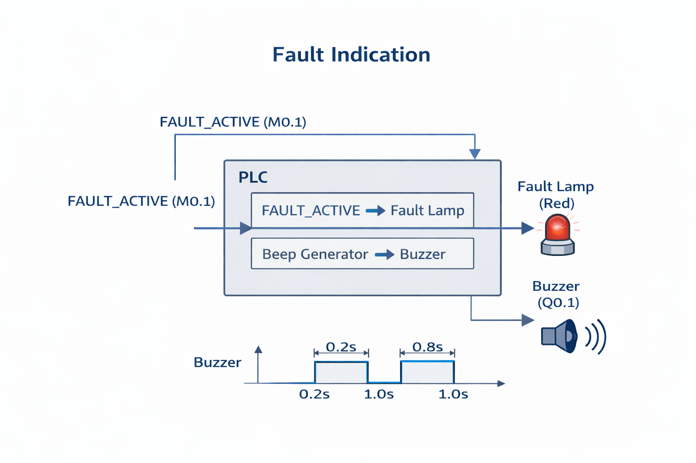
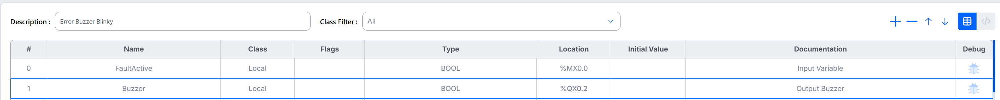

# 08 Blinky - Fault Indicator

## Process Diagram

The diagram depicts `FAULT_ACTIVE` at `%M0.1`, a red fault lamp, and a buzzer at `Q0.1`. It does not match the ladder source, rung screenshot, or variable screenshot in this folder. Those describe a cycle-running blinky: `RunState` at `%MX0.0` drives `CycleOn` at `%QX0.2`. The implementation below follows `pous/programs/main.ld`; this process diagram appears to describe a different fault-indicator program. In the source, `RunState` is a memory bit and is not mapped to a physical input.

## Variables

| Variable | Type | Address | Role |
| --- | --- | --- | --- |
| `RunState` | `BOOL` | `%MX0.0` | Memory bit that enables the cycle-running indicator. The source comment calls it an input variable, but it is not a physical input address. |
| `CycleOn` | `BOOL` | `%QX0.2` | Digital output for the cycle-running indicator. |
| `TON0` | `TON` | - | On-delay timer with a 0.5 s preset. |
| `TOF0` | `TOF` | - | Off-delay timer with a 0.5 s preset. |

No initial values are declared. `project.json` schedules `main` on `task0`, a cyclic task with a 20 ms interval and priority 1.

## Rungs

### Rung 1 - Main Rung

This single series path uses a normally open `RunState` contact, a negated (normally closed) `CycleOn` contact, `TON0`, `TOF0`, and the `CycleOn` coil. Both timers have a preset of `T#0.5s`.

**Power-flow sequence**

1. Each cyclic scan evaluates the path from the left rail. `RunState` must be `TRUE`, and the negated `CycleOn` contact passes only while the output is `FALSE`.
2. While both contacts pass, `TON0.IN` is true. After 0.5 s, `TON0.Q` becomes true and enables `TOF0.IN`.
3. The TOF output is true while its input is true, so `TOF0.Q` energizes the `CycleOn` coil at `%QX0.2`. On the following scan, the output is true and its negated feedback contact opens, interrupting the TON input.
4. `TON0` resets. `TOF0` then holds its output true for the 0.5 s off-delay, keeping `CycleOn` on for that interval. When the off-delay expires, the output turns off, the feedback contact closes, and the next TON interval starts if `RunState` remains true.
5. With `RunState` continuously true, the result is approximately 0.5 s on and 0.5 s off, or a 1 Hz cycle. The 20 ms task interval limits transition resolution. If `RunState` becomes false, the path drops and the TOF may keep the output on for its remaining off-delay before turning it off.

The rung controls only the `CycleOn` output. It does not implement a fault lamp or buzzer as shown in the process diagram.