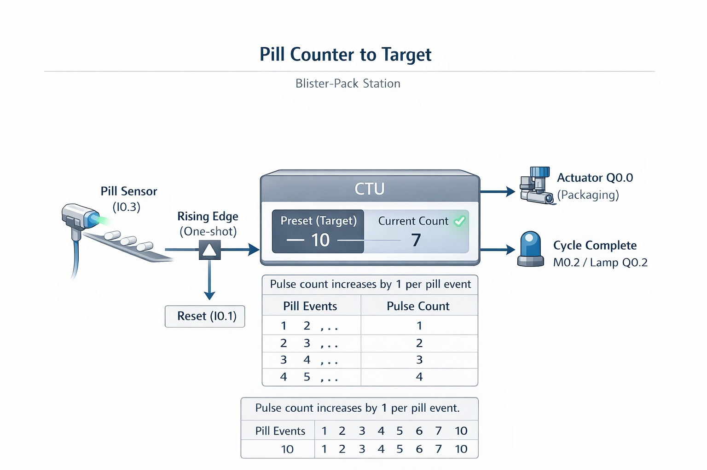
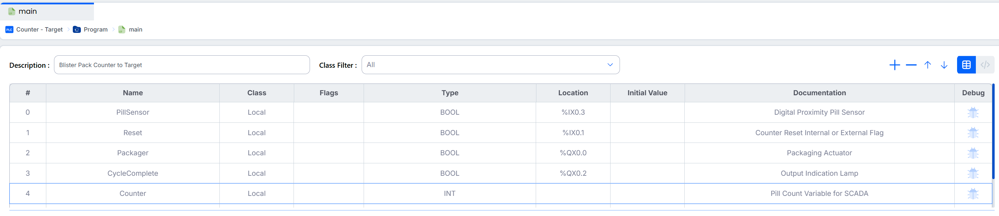

# 09 Counter - Blister Package Target

## Process Diagram

The diagram shows a pill sensor, a rising-edge count, a target of 10, a packaging actuator, and a cycle-complete indication. The target and I/O labels broadly match the declarations, but the diagram omits important source behavior: the ladder routes the counter's `Q` output through a `Reset` coil and a 5 s `TOF0` before energizing `Packager` and `CycleComplete`. The diagram's displayed current count of 7 is an example display value, not a declared initial value. It also labels cycle complete as `M0.2 / Lamp Q0.2`; the source declares only `%QX0.2` for `CycleComplete`.

## Variables

| Variable | Type | Address | Role |
| --- | --- | --- | --- |
| `PillSensor` | `BOOL` | `%IX0.3` | Digital proximity input whose rising edges represent pill events. |
| `Reset` | `BOOL` | `%IX0.1` | Digital reset input connected to the counter reset port. The source also uses this variable as a coil, described under Rung 1. |
| `Packager` | `BOOL` | `%QX0.0` | Digital output for the packaging actuator. |
| `CycleComplete` | `BOOL` | `%QX0.2` | Digital output for a cycle-complete indication. |
| `Counter` | `INT` | - | Counter current-value destination, documented as a pill-count value for SCADA. |
| `CTU0` | `CTU` | - | Up-counter with `PV` set to 10. |
| `TOF0` | `TOF` | - | Off-delay timer with a 5 s preset. |

No initial values are declared. `project.json` schedules `main` on `task0`, a cyclic task with a 20 ms interval and priority 1.

## Rungs

### Rung 1 - Main Rung

The rung begins with a rising-edge `PillSensor` contact and passes its pulse to `CTU0.CU`. `CTU0.R` is connected to `Reset`, `CTU0.PV` is the literal 10, and `CTU0.CV` is written to `Counter`. The counter's `Q` output drives a `Reset` coil, whose value then feeds both the counter reset input and `TOF0.IN`. `TOF0.PT` is `T#5s`; `TOF0.Q` feeds the `Packager` and `CycleComplete` coils in the same rung path.

**Power-flow sequence**

1. The rising-edge contact passes for a scan when `PillSensor` changes from `FALSE` to `TRUE`. A sensor held true does not create a new count pulse on every scan.
2. Each pulse increments `CTU0` by one. The current value is copied to `Counter`; the literal preset is 10. The counter reset port is driven by `Reset`, and the standard CTU `Q` output becomes true when the count reaches its preset, subject to the reset input.
3. When `CTU0.Q` is true, the rung energizes the `Reset` coil. This is a notable source-level issue: `Reset` is declared at input address `%IX0.1`, but the ladder uses it as a coil as well as a CTU reset signal. A PLC input image is normally supplied by the input hardware, not driven by an output coil. Do not assume this rung can physically generate a reset pulse; the exact result depends on the target runtime's handling of writes to an input-mapped variable.
4. The `Reset` value also drives `TOF0.IN`. A true input makes `TOF0.Q` true, energizing both `%QX0.0` (`Packager`) and `%QX0.2` (`CycleComplete`). When `TOF0.IN` goes false, the TOF keeps `Q` true for 5 s, then both coils turn off. If the input remains true, the outputs remain energized.
5. These coils are in one serialized rung path, not separate branches. The code therefore describes outputs following the TOF path; it does not show an independent permissive or interlock for the actuator.

The diagram presents the CTU and outputs as a direct target-count sequence. The actual rung's reset coil and timed output hold must be considered when interpreting or commissioning this example.