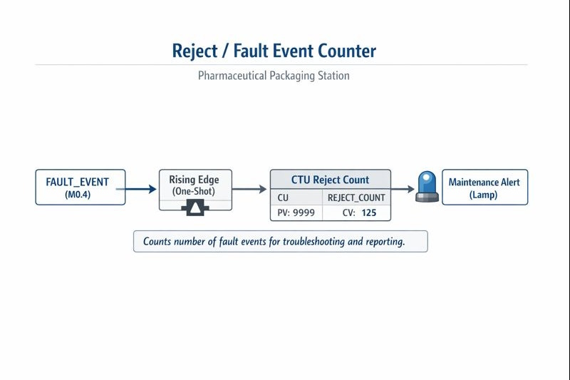
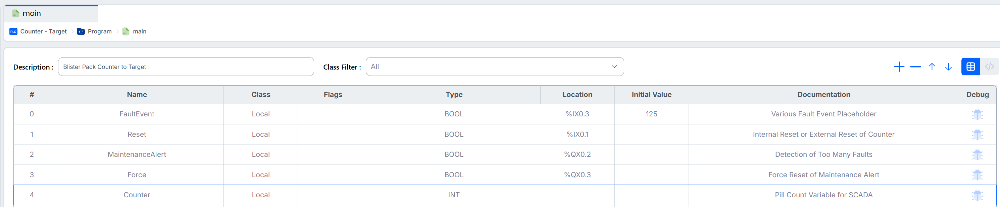

# 10 Counter - Maintenance Alert

## Process Diagram

The diagram shows a fault-event counter with a preset of 9999 and a maintenance lamp. The preset and general purpose match the ladder, but some details diverge. The diagram labels the event as `%M0.4`; the source maps `FaultEvent` to `%IX0.3`. The diagram's displayed `CV: 125` is an example count, not an initialized counter value. The source instead contains the unusual declaration `FaultEvent : BOOL AT %IX0.3 := 125`, which assigns a numeric initializer to a Boolean variable. The ladder also uses a `Reset` coil and an `SR` latch reset input that are not explained in the diagram.

## Variables

| Variable | Type | Address | Role |
| --- | --- | --- | --- |
| `FaultEvent` | `BOOL` | `%IX0.3` | Event input counted on rising edges. The source explicitly declares `:= 125`, which is inconsistent with the declared `BOOL` type. |
| `Reset` | `BOOL` | `%IX0.1` | Connected to the CTU reset port and used as a rung coil to set the SR latch. |
| `MaintenanceAlert` | `BOOL` | `%QX0.2` | Digital output for the maintenance alert. |
| `Force` | `BOOL` | `%QX0.3` | Connected to the SR latch reset port; no rung in this program drives this output variable. |
| `Counter` | `INT` | - | CTU current-value destination, documented as a count for SCADA. |
| `CTU0` | `CTU` | - | Up-counter with preset value 9999. |
| `TOF0` | `TOF` | - | Declared timer instance; it is not connected in the rung. |
| `SR0` | `SR` | - | Set-reset latch used to retain the maintenance-alert state. |

`FaultEvent` is the only variable with an explicit initializer, and `125` is not a valid Boolean value to assume as a meaningful initial state. No initial value is declared for `Counter` or the timer/latch instances. `project.json` schedules `main` on `task0`, a cyclic task with a 20 ms interval and priority 1.

## Rungs

### Rung 1 - Main Rung

The rung uses a rising-edge `FaultEvent` contact to drive `CTU0.CU`. `CTU0.R` is connected to `Reset`, `CTU0.PV` is the literal 9999, and `CTU0.CV` is written to `Counter`. `CTU0.Q` drives a `Reset` coil; that signal feeds `SR0.S1`. `Force` feeds `SR0.R`, and `SR0.Q1` drives the `MaintenanceAlert` coil. The declared `TOF0` does not appear in this rung.

**Power-flow sequence**

1. On each scan, the rising-edge contact passes for a scan when `FaultEvent` changes from `FALSE` to `TRUE`; a steady high level does not increment the counter on every scan.
2. `CTU0` increments on that pulse, reports its current value through `Counter`, and compares the count with its preset of 9999. The CTU `Q` output becomes true at the preset unless its `R` input is asserted.
3. When `CTU0.Q` is true, the rung energizes the `Reset` coil. `Reset` is also wired to the CTU's `R` port and the SR latch's `S1` port. As with the preceding counter project, this is a source-level concern: `Reset` is declared at input address `%IX0.1` but is used as a coil. A standard physical input image is not normally driven by a ladder output coil, so the reset/set sequence depends on the target runtime's treatment of writes to an input-mapped variable.
4. A true `S1` sets `SR0.Q1`, which energizes `MaintenanceAlert` at `%QX0.2`. The SR latch retains the alert after the counter output drops; its reset input is `Force`. For the standard set-dominant `SR` block, a simultaneous set and reset leaves the set state active.
5. `Force` is mapped to output `%QX0.3`, not to a physical input, and no coil in this rung drives it. Thus the source contains no ordinary pushbutton input for clearing the latch; the alert clears only if the `Force` value presented to `SR0.R` becomes true through an external forcing or other project/runtime mechanism.

The diagram's `CV: 125` should not be read as a program startup value. The source's only `125` initializer belongs to the Boolean `FaultEvent` declaration, while `Counter` has no initializer.