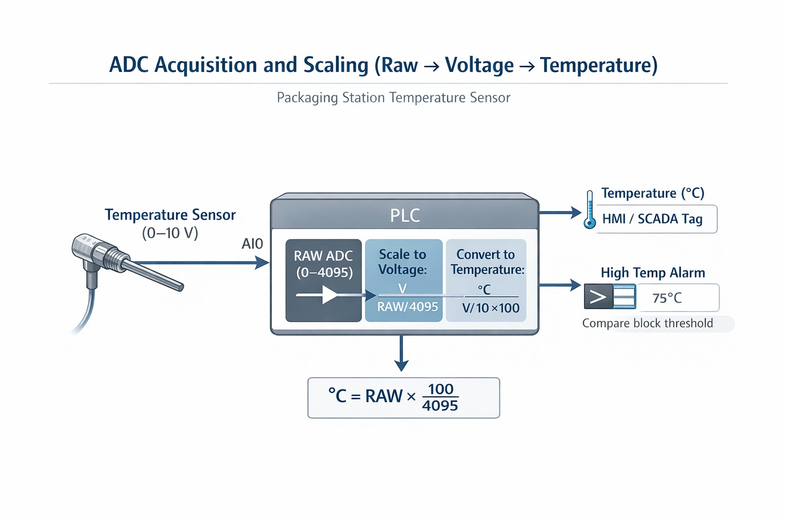
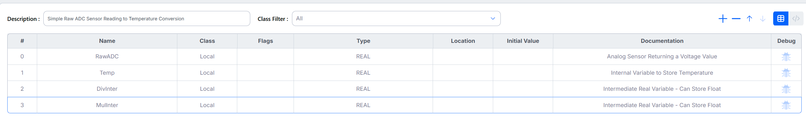

# 11 Maths - ADC Acquisition

## Process Diagram

The diagram depicts an analog input with a 0-4095 range, scaling by 100/4095 to a temperature value, an HMI/SCADA temperature tag, and a 75 degree C alarm comparison. Those functions are not implemented by the ladder source. The source divides `RawADC` by 255, multiplies that result by 500, then subtracts 0.25; the final `SUB` output is unconnected. `Temp` is declared but is not written, and there is no analog I/O address or comparator in the source. The implementation below follows `pous/programs/main.ld`, not the wider process illustration.

## Variables

| Variable | Type | Address | Role |
| --- | --- | --- | --- |
| `RawADC` | `REAL` | - | Numeric input used by the division block. It has no declared analog channel address in this program. |
| `Temp` | `REAL` | - | Declared temperature value; no rung writes to it. |
| `DivInter` | `REAL` | - | Intermediate result of `RawADC / 255`. |
| `MulInter` | `REAL` | - | Intermediate result of `DivInter * 500`. |

All four variables are local `REAL` declarations with no explicit addresses or initial values. `project.json` schedules `main` on `task0`, a cyclic task with a 20 ms interval and priority 1.

## Rungs

### Rung 1 - Main Rung

This rung has no Boolean contacts or output coils. The left power rail enables `DIV`; its `ENO` enables `MUL`, whose `ENO` enables `SUB`. The connected operands and results are:

- `DIV`: `IN1 = RawADC`, `IN2 = 255`, `OUT = DivInter`.
- `MUL`: `IN1 = DivInter`, `IN2 = 500`, `OUT = MulInter`.
- `SUB`: `IN1 = MulInter`, `IN2 = 0.25`; its `OUT` has no declared variable connected.

**Power-flow sequence**

1. On each cyclic scan, the rung's left-to-right enable path energizes the `DIV` block. It evaluates `RawADC / 255` and writes the result to `DivInter`.
2. When `DIV.ENO` is true, it enables `MUL`. The multiplication uses the current `DivInter` value and the literal 500, then writes the result to `MulInter`.
3. When `MUL.ENO` is true, it enables `SUB`, which evaluates `MulInter - 0.25`. The block's output node is unconnected in the source, so this value is not assigned to `Temp` or another named program variable.
4. The `SUB.ENO` connection reaches the right rail. There are no contacts to condition the calculations and no coils, alarms, or mapped analog I/O in this rung. `Temp` therefore remains unwritten by this program, and the source alone does not establish where `RawADC` gets its value.

The rung screenshot agrees with the serialized block sequence and constants. It should not be interpreted as the 0-4095 temperature conversion shown in the process diagram.