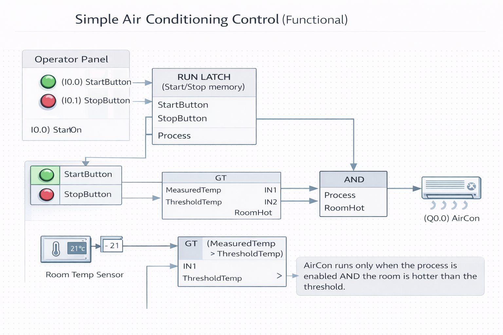
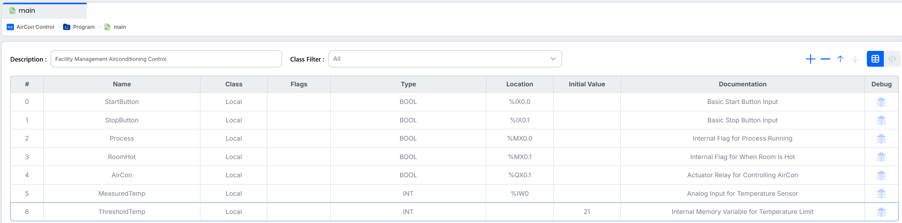

# AirCon Control

## Diagram

This project is described in the source as facility-management air-conditioning control. It can illustrate environmental control relevant to a manufacturing facility, but it is not a pill-production sequence and contains no product or recipe logic. The diagram shows the room-temperature comparison and the run permissive.

There is an output-address mismatch: the diagram labels `AirCon` as `%Q0.0`, while the program and variable screenshot declare it at `%QX0.1`. The diagram presents the threshold as 21 degrees, but the source declares only an `INT` value of `21`; no engineering unit or input scaling is defined in the program.

## Variables

| Variable | Type | Address | Initial value | Role in the program |
| --- | --- | --- | --- | --- |
| `StartButton` | `BOOL` | `%IX0.0` | Not specified | Start push-button input for the `Process` latch. |
| `StopButton` | `BOOL` | `%IX0.1` | Not specified | Stop push-button input; its negated contact interrupts the latch path when the input is TRUE. |
| `Process` | `BOOL` | `%MX0.0` | Not specified | Internal run-state bit set by the start/stop rung. |
| `RoomHot` | `BOOL` | `%MX0.1` | Not specified | Internal result of comparing the measured temperature with the threshold. |
| `AirCon` | `BOOL` | `%QX0.1` | Not specified | Physical air-conditioning control output. |
| `MeasuredTemp` | `INT` | `%IW0` | Not specified | Raw integer input from the temperature sensor; no conversion is shown. |
| `ThresholdTemp` | `INT` | No `AT` address | `21` | Local comparison threshold used by the `GT` block. |

`project.json` schedules `main` as a cyclic task every `T#20ms`. `ThresholdTemp` is the only variable with an explicit initial value; no other initial values are declared.

## Rungs

### Rung 1 - Start Latch

The parallel branches implement a seal-in path: a normally open `StartButton` contact is in parallel with a normally open `Process` feedback contact. The branches rejoin before a negated (normally closed) `StopButton` contact and the `Process` coil.

**Power-flow sequence**

1. Power from the left rail can pass through either `StartButton` when it is TRUE or the `Process` feedback contact when the process bit is already TRUE.
2. The paths rejoin and pass through the negated `StopButton` contact only while `StopButton` is FALSE.
3. If the combined path reaches the `Process` coil, `%MX0.0` is written TRUE. The feedback contact then maintains the path after the start button is released.
4. When `StopButton` becomes TRUE, its negated contact opens, the coil is written FALSE, and the feedback path is lost. A simultaneous start and stop does not bypass the stop contact.

The Boolean condition is `Process = (StartButton OR Process) AND NOT StopButton`. There is no separate latch function block or explicit initial state.

### Rung 2 - Temperature Comparison

The `GT` (greater-than) function block is enabled from the left rail. `MeasuredTemp` is wired to `IN1`, `ThresholdTemp` to `IN2`, and the block's `OUT` is wired to the `RoomHot` coil. The `ENO` output continues to the right rail; the comparison result reaches the coil through the separate `OUT` connection.

**Power-flow sequence**

1. The enabled block evaluates the current `%IW0` integer against the local threshold value `21`.
2. `OUT` is TRUE only when `MeasuredTemp > ThresholdTemp`; equality does not satisfy `GT`.
3. A TRUE `OUT` energizes `RoomHot` at `%MX0.1`; otherwise that ordinary coil is written FALSE on the scan.

The source does not convert the analog input to degrees or assign units to either value, so the code-grounded condition is a comparison of integer values, not a verified 21-degree measurement.

### Rung 3 - AirCon Control

This rung has two normally open contacts in series: `Process`, then `RoomHot`, followed by the `AirCon` output coil.

**Power-flow sequence**

1. Power passes the first contact only while the run latch `Process` is TRUE.
2. From there it passes the `RoomHot` contact only while the comparison in Rung 2 is TRUE.
3. Only when both conditions are TRUE does power reach `AirCon`; the output at `%QX0.1` is then TRUE. If either contact opens, the ordinary coil is written FALSE.

In Boolean form, `AirCon = Process AND RoomHot`. The output follows the two conditions each cyclic scan; this rung contains no output latch or temperature hysteresis.