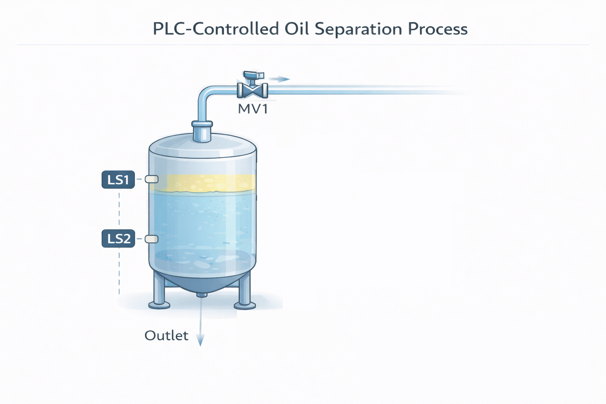
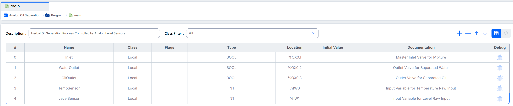

# Analog Level Sensing - Oil Separation

## Diagram

The program comment describes a herbal-oil separation process controlled by analog level sensing. This is process-control logic relevant to manufacturing, but the source does not identify it as a pill-production line. The drawing is an overall process illustration; the implemented control is defined by the three ladder rungs below.

The diagram labels the feed valve `MV1` and level points `LS1` and `LS2`, while the program uses `Inlet`, `WaterOutlet`, `OilOutlet`, and a single integer `LevelSensor`. In particular, the source does not declare separate binary LS1/LS2 inputs. `TempSensor` is present in the variable list but is not used by any rung. The process drawing also does not show that temperature input or the two separately controlled outlet coils.

## Variables

| Variable | Type | Address | Initial value | Role in the program |
| --- | --- | --- | --- | --- |
| `Inlet` | `BOOL` | `%QX0.1` | Not specified | Master mixture inlet-valve output. |
| `WaterOutlet` | `BOOL` | `%QX0.2` | Not specified | Separated-water outlet-valve output. |
| `OilOutlet` | `BOOL` | `%QX0.3` | Not specified | Separated-oil outlet-valve output. |
| `TempSensor` | `INT` | `%IW0` | Not specified | Raw integer temperature input; not referenced in the ladder logic. |
| `LevelSensor` | `INT` | `%IW1` | Not specified | Raw integer level input used by the `EQ` and `LE` comparisons. |

`project.json` schedules `main` as a cyclic task every `T#20ms`. The source provides no initial values or analog scaling/engineering-unit conversion for these variables. The numeric limits below therefore refer to raw `LevelSensor` integer values.

## Rungs

### Rung 1 - Inlet Valve Control

An enabled `EQ` (equal) block compares `LevelSensor` at `IN1` with the constant `0` at `IN2`. Its `OUT` feeds two series negated contacts, `WaterOutlet` then `OilOutlet`, followed by the `Inlet` coil. `ENO` continues to the right rail, while the comparison `OUT` starts the control path to the contacts.

**Power-flow sequence**

1. The block evaluates `LevelSensor = 0` while enabled.
2. Its `OUT` passes power onward only when the comparison is TRUE.
3. The negated `WaterOutlet` contact conducts only while `WaterOutlet` is FALSE; the following negated `OilOutlet` contact conducts only while `OilOutlet` is FALSE.
4. If all three conditions hold, `Inlet` is energized at `%QX0.1`. A nonzero level value or either active outlet blocks the inlet coil.

Thus `Inlet = (LevelSensor = 0) AND NOT WaterOutlet AND NOT OilOutlet`. This is direct, scan-by-scan coil control, not a retained fill command.

### Rung 2 - Water Outlet Valve Control

The enabled `LE` (less-than-or-equal) block compares `LevelSensor` (`IN1`) with `200` (`IN2`). Its `OUT` feeds a negated `OilOutlet` contact and then a negated `Inlet` contact, ending at the `WaterOutlet` coil. The block's `ENO` is connected to the right rail.

**Power-flow sequence**

1. `OUT` is TRUE when `LevelSensor <= 200`; the equality case at 200 is included.
2. Power then passes the `OilOutlet` contact only while that output is FALSE.
3. It passes the `Inlet` contact only while the inlet output is FALSE.
4. When all conditions are true, `WaterOutlet` at `%QX0.2` is energized. If the comparison fails or either interlock output is TRUE, the coil is not energized.

The rung does not check temperature and does not specify a lower bound for the water-outlet condition.

### Rung 3 - Oil Outlet Valve Control

The enabled `LE` block compares `LevelSensor` (`IN1`) with `20` (`IN2`). Its comparison output feeds a single negated `WaterOutlet` contact and then the `OilOutlet` coil.

**Power-flow sequence**

1. The `LE` output passes power when `LevelSensor <= 20`, including exactly 20.
2. The negated `WaterOutlet` contact conducts only while the water outlet is FALSE.
3. If both conditions are true, the `OilOutlet` coil at `%QX0.3` is energized; otherwise it is written FALSE.

The water and oil outlet rungs use reciprocal normally closed output contacts, so each rung blocks its outlet while the other outlet variable is TRUE. The oil rung does not include an `Inlet` interlock; only the comparison and `WaterOutlet` contact control it.