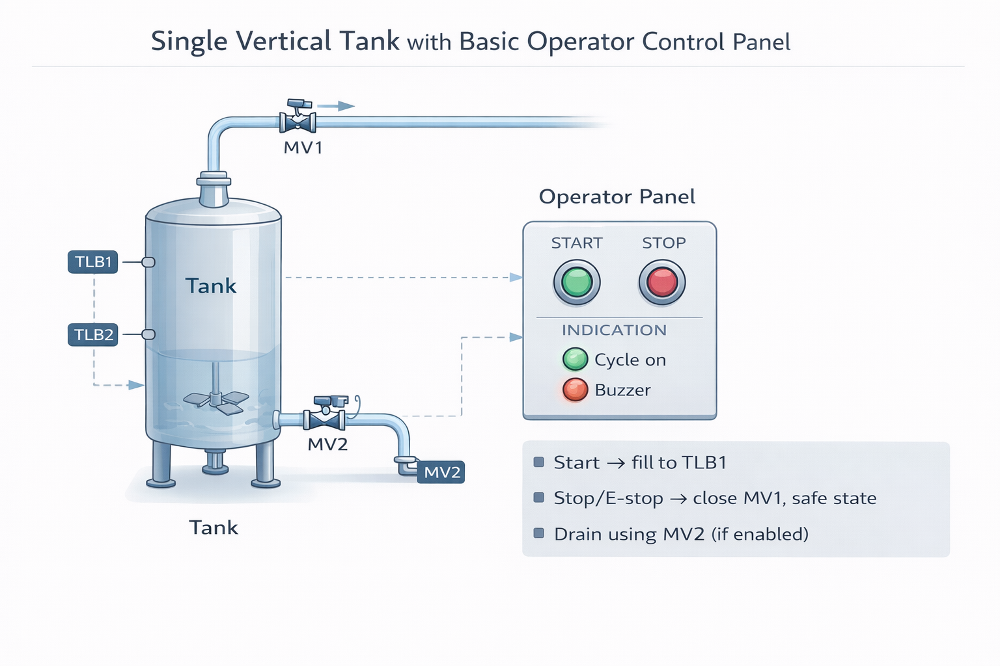
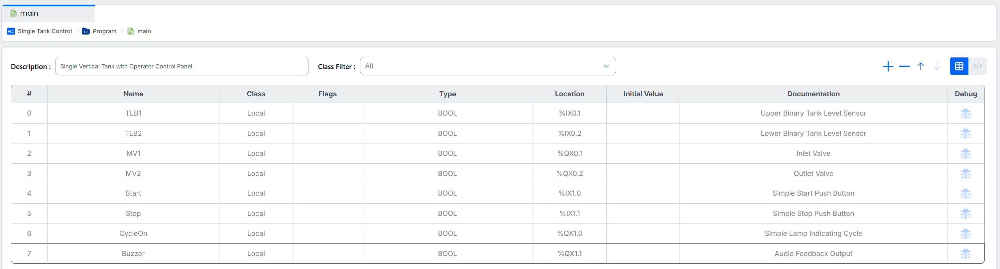

# Single Tank Control

## Diagram

This is a generic single-vessel level-control example that can represent a manufacturing process tank. The source does not identify a product, recipe, or pill-manufacturing operation. The drawing describes filling to the upper sensor and draining through the outlet.

The diagram says “Stop/E-stop” and describes a safe state, but the program declares only one `Stop` input and contains no separate emergency-stop input or safety-rated logic. Its statement that stop closes the inlet is consistent with the `CycleOn` permissive in the inlet rung; it should not be read as evidence of an emergency-stop function. The variable screenshot lists the eight BOOL I/O variables but omits the declared `SR0` and `SR1` function-block instances shown in the ladder images.

## Variables

| Variable | Type | Address | Initial value | Role in the program |
| --- | --- | --- | --- | --- |
| `TLB1` | `BOOL` | `%IX0.1` | Not specified | Upper binary tank-level sensor. |
| `TLB2` | `BOOL` | `%IX0.2` | Not specified | Lower binary tank-level sensor. |
| `MV1` | `BOOL` | `%QX0.1` | Not specified | Inlet-valve output. |
| `MV2` | `BOOL` | `%QX0.2` | Not specified | Outlet-valve output. |
| `Start` | `BOOL` | `%IX1.0` | Not specified | Start push-button input. |
| `Stop` | `BOOL` | `%IX1.1` | Not specified | Stop push-button input; connected to the reset input of `SR0`. |
| `CycleOn` | `BOOL` | `%QX1.0` | Not specified | Cycle-status lamp/output driven by `SR0.Q1`. |
| `Buzzer` | `BOOL` | `%QX1.1` | Not specified | Buzzer output driven by `SR1.Q1`. |
| `SR0` | `SR` | No `AT` address | Not specified | Set/reset function-block instance for the run state. |
| `SR1` | `SR` | No `AT` address | Not specified | Set/reset function-block instance for the outlet/buzzer state. |

`project.json` schedules `main` as a cyclic task every `T#20ms`. No initial values are declared for the BOOL variables or either stateful function-block instance.

## Rungs

### Rung 1 - CycleOn Control

The normally open `Start` contact feeds `SR0.S1`; the normally open `Stop` contact feeds `SR0.R`. The function-block output `Q1` drives the `CycleOn` coil.

**Power-flow sequence**

1. When `Start` is TRUE, power reaches the set input `S1` of `SR0`.
2. When `Stop` is TRUE, its separate branch reaches the reset input `R`.
3. `SR0.Q1` drives `CycleOn` at `%QX1.0`; the state is retained by the SR block rather than by a ladder seal-in contact.
4. Under the standard set-dominant `SR` behavior, simultaneous TRUE set and reset inputs leave the set state dominant. The rung therefore does not implement a stop-priority interlock for simultaneous button inputs.

The source does not initialize `SR0` or `CycleOn`; the startup state is not specified here.

### Rung 2 - Inlet Valve Control

Three series contacts control the `MV1` coil: normally open `CycleOn`, negated `TLB1`, and negated `MV2`.

**Power-flow sequence**

1. The cycle must be active for power to pass the `CycleOn` contact.
2. The negated `TLB1` contact conducts only while the upper-level input is FALSE, so an asserted upper sensor blocks filling.
3. The negated `MV2` contact conducts only while the outlet valve is off, preventing the inlet command while the outlet command is active.
4. If all three contacts conduct, `MV1` at `%QX0.1` is energized. If any condition fails, the ordinary coil is written FALSE.

`TLB2` is not used in this inlet rung; the upper sensor is the fill cutoff represented by the source.

### Rung 3 - Outlet Valve Control

The rung has two branches, each beginning with a normally open `CycleOn` contact. The upper branch continues through the rising-edge (`P`) contact for `TLB1` to `SR1.S1`; the lower branch continues through the falling-edge (`N`) contact for `TLB2` to `SR1.R`. `SR1.Q1` then drives the `Buzzer` and `MV2` coils in series.

**Power-flow sequence**

1. While `CycleOn` is TRUE, a false-to-true transition of `TLB1` produces a one-scan pulse through the upper branch and sets `SR1`.
2. While `CycleOn` is TRUE, a true-to-false transition of `TLB2` produces a one-scan pulse through the lower branch and resets `SR1`.
3. When `SR1.Q1` is TRUE, both `Buzzer` at `%QX1.1` and outlet valve `MV2` at `%QX0.2` are energized together; when Q1 is FALSE, both coils are off.
4. The Q1 output leg has no `CycleOn` contact. Therefore stopping the cycle does not itself reset `SR1` or force these two outputs off. The reset event is also gated by `CycleOn`, so verify the retained outlet/buzzer state against the intended operating sequence.

No separate buzzer-only condition or independent outlet command is present in this rung.