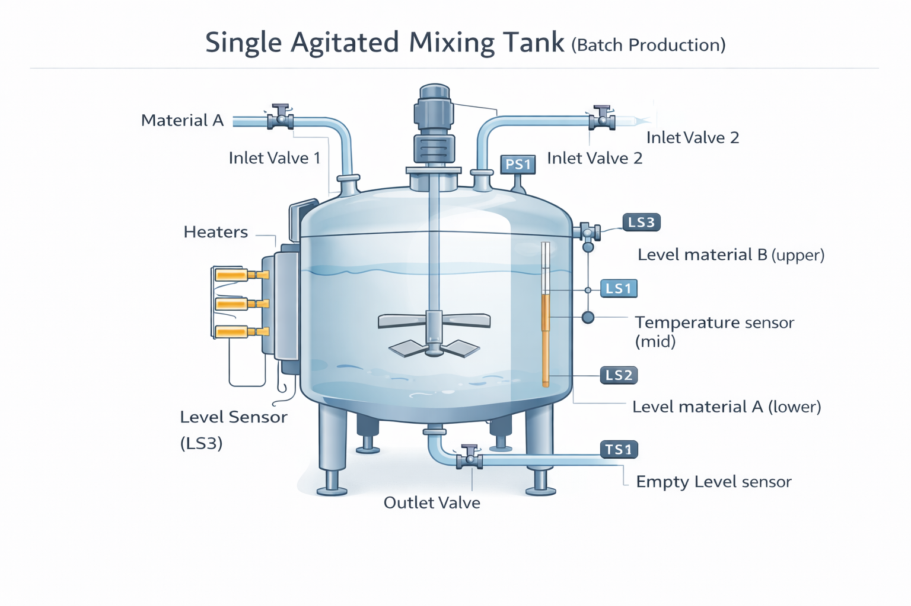
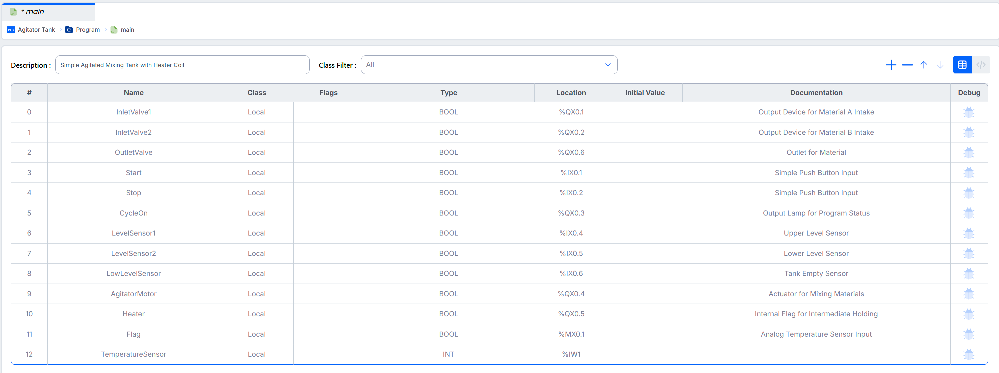

# Single Agitated Mixing Tank

## Diagram

The diagram describes batch production in a single agitated vessel. The source does not name a product or identify this as a pill line; it is a generic mixing and heating sequence relevant to manufacturing process control.

The process drawing uses tags such as `LS1`, `LS2`, `LS3`, `TS1`, and `PS1`, while the source declares `LevelSensor1`, `LevelSensor2`, `LowLevelSensor`, and `TemperatureSensor`. There is no `PS1` variable in the program. The source comments identify `LevelSensor1` as the upper level sensor and `LowLevelSensor` as the tank-empty sensor; the variable screenshot describes `LevelSensor2` as the lower sensor. The diagram and source therefore do not use a consistent tag set.

The variable screenshot also misdescribes two BOOLs: it calls `Heater` an internal flag even though source locates it at output `%QX0.5`, and calls `Flag` an analog temperature input even though the source declares it as BOOL memory `%MX0.1` driven by the temperature comparison. The screenshot omits `TP0`, although the source declares it and the Mixing Control rung labels and uses that timer instance.

## Variables

| Variable | Type | Address | Initial value | Role in the program |
| --- | --- | --- | --- | --- |
| `InletValve1` | `BOOL` | `%QX0.1` | Not specified | Material A inlet-valve output. |
| `InletValve2` | `BOOL` | `%QX0.2` | Not specified | Material B inlet-valve output. |
| `OutletValve` | `BOOL` | `%QX0.6` | Not specified | Bottom discharge-valve output. |
| `Start` | `BOOL` | `%IX0.1` | Not specified | Start push-button input. |
| `Stop` | `BOOL` | `%IX0.2` | Not specified | Stop push-button input. |
| `CycleOn` | `BOOL` | `%QX0.3` | Not specified | Cycle-status output, also used as the run permissive. |
| `LevelSensor1` | `BOOL` | `%IX0.4` | Not specified | Upper-level sensor per the source declaration comment. |
| `LevelSensor2` | `BOOL` | `%IX0.5` | Not specified | BOOL level input; the variable screenshot describes it as the lower-level sensor. |
| `LowLevelSensor` | `BOOL` | `%IX0.6` | Not specified | Tank-empty sensor per the source declaration comment. |
| `AgitatorMotor` | `BOOL` | `%QX0.4` | Not specified | Agitator motor output. |
| `Heater` | `BOOL` | `%QX0.5` | Not specified | Heater output, controlled through `Flag` and `CycleOn`. |
| `Flag` | `BOOL` | `%MX0.1` | Not specified | Internal BOOL set when `TemperatureSensor < 30`. |
| `TemperatureSensor` | `INT` | `%IW1` | Not specified | Raw integer temperature input; no scale or unit is specified. |
| `TP0` | `TP` | No `AT` address | Not specified | Pulse-timer instance used by the Mixing Control rung with `PT = T#5s`. |

`project.json` schedules `main` as a cyclic task every `T#20ms`. No variable has an explicit initial value. The comparison constants `30` and timer preset `T#5s` are rung parameters, not declared variable initial values.

## Rungs

### Rung 1 - CycleOn Control

The normally open `Start` contact and normally open `CycleOn` feedback contact form parallel branches. After they rejoin, a negated (normally closed) `Stop` contact is in series with the `CycleOn` coil.

**Power-flow sequence**

1. The upper branch conducts while `Start` is TRUE; after the cycle starts, the lower feedback branch conducts while `CycleOn` is TRUE.
2. The shared path continues only while `Stop` is FALSE.
3. If power reaches the coil, `CycleOn` at `%QX0.3` is written TRUE and its feedback contact maintains the path after `Start` is released.
4. When `Stop` is TRUE, the negated contact opens and the coil is written FALSE, removing the seal-in path.

The rung condition is `CycleOn = (Start OR CycleOn) AND NOT Stop`.

### Rung 2 - Material A Inlet Valve Control

The `InletValve1` coil is controlled by three normally open/closed conditions in series: normally open `CycleOn`, negated `OutletValve`, and negated `LevelSensor1`.

**Power-flow sequence**

1. `CycleOn` must be TRUE.
2. The negated `OutletValve` contact conducts only while discharge is off.
3. The negated `LevelSensor1` contact conducts only while the upper-level input is FALSE.
4. When all three contacts conduct, `InletValve1` at `%QX0.1` is energized; an active outlet or asserted upper sensor turns the coil off.

This rung does not check `LevelSensor2` or impose a timed fill. It directly gates the Material A inlet from the cycle, outlet state, and upper sensor.

### Rung 3 - Material B Inlet Valve Control

Four series conditions control the `InletValve2` coil: normally open `CycleOn`, then negated `OutletValve`, `InletValve1`, and `LevelSensor2` contacts.

**Power-flow sequence**

1. The cycle must be active.
2. Discharge must be off because the `OutletValve` contact is negated.
3. `InletValve1` must be FALSE, so the two inlet outputs are not commanded on together by these rungs.
4. `LevelSensor2` must be FALSE for its negated contact to conduct.
5. If the whole series path is complete, `InletValve2` at `%QX0.2` is energized; any open condition turns it off.

The source uses the lower-level input name from the variable screenshot but does not add a separate batch-step memory or timer to prove that Material A has completed before Material B is admitted.

### Rung 4 - Temperature Flag Trigger

An enabled `LT` (less-than) function block compares `TemperatureSensor` (`IN1`) with the constant `30` (`IN2`). Its `OUT` drives the `Flag` coil; `ENO` continues to the right rail.

**Power-flow sequence**

1. The block evaluates the raw `%IW1` integer each scan.
2. `OUT` is TRUE only when `TemperatureSensor < 30`; a value of exactly 30 does not satisfy the comparison.
3. A TRUE result energizes internal bit `Flag` at `%MX0.1`; a FALSE result writes the ordinary coil FALSE.

This rung is not gated by `CycleOn`, so the flag can reflect the comparison even while the batch cycle is stopped. No temperature unit, scaling, or hysteresis is specified.

### Rung 5 - Heater Control

Normally open `CycleOn` and `Flag` contacts are in series before the `Heater` coil.

**Power-flow sequence**

1. The cycle permissive must be TRUE.
2. The `Flag` contact must also be TRUE, which Rung 4 establishes when the raw sensor value is below 30.
3. Only then does power reach `Heater` at `%QX0.5`. If either condition is FALSE, the coil is written FALSE.

The program therefore requests heating below the comparison threshold while the cycle is active. The source does not define the sensor's physical unit or an independent over-temperature trip.

### Rung 6 - Mixing Control

Normally open `CycleOn` and `LevelSensor2` contacts are in series to the `IN` input of pulse timer `TP0`. Its preset time is `T#5s`; `TP0.Q` drives `AgitatorMotor`. The elapsed-time (`ET`) output is not connected to a used variable.

**Power-flow sequence**

1. The timer input is TRUE only while both `CycleOn` and `LevelSensor2` are TRUE.
2. On a rising edge at `TP0.IN`, the `TP` block makes `Q` TRUE for its five-second preset interval.
3. While `Q` is TRUE, the `AgitatorMotor` coil at `%QX0.4` is energized; when the pulse expires, the output turns off even if the input remains TRUE.
4. Another pulse requires the timer input to return FALSE and then rise again. This is a timed pulse, not continuous agitation for as long as the level contact is closed.

### Rung 7 - Discharge Control

The series path contains normally open `CycleOn` and `LowLevelSensor` contacts, followed by negated `AgitatorMotor`, `InletValve1`, and `InletValve2` contacts, then the `OutletValve` coil.

**Power-flow sequence**

1. The cycle must be active and `LowLevelSensor` must be TRUE; that sensor contact is not negated.
2. The agitator must be off, and both inlet-valve output variables must be FALSE for the three negated contacts to conduct.
3. If every contact conducts, `OutletValve` at `%QX0.6` is energized. A running agitator or active inlet blocks discharge.

The source comment identifies `LowLevelSensor` as a tank-empty sensor. If TRUE means “empty” on the installed sensor, this rung energizes the outlet when the tank is reported empty; confirm that polarity and intended discharge behavior during commissioning. The rung has no additional level or temperature condition.