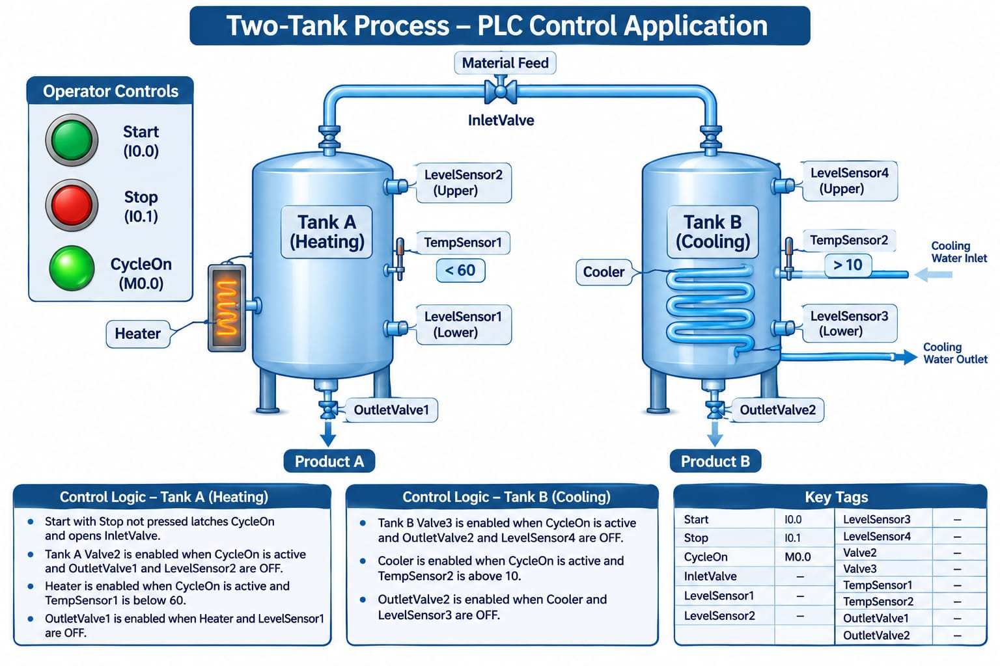
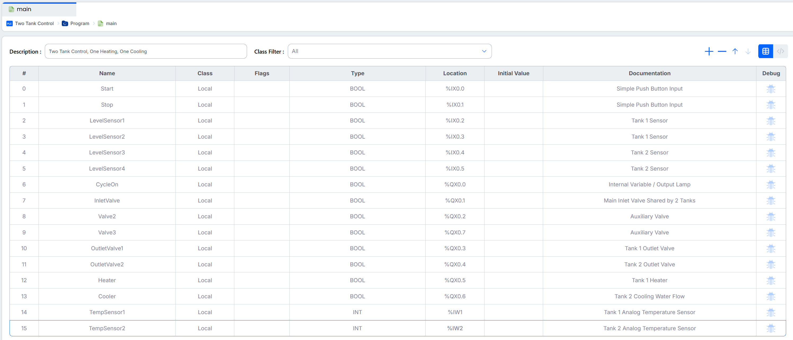

# Two Tank Control - Heat and Cool

## Diagram

The diagram and source describe a generic two-tank process with heating in Tank 1 and cooling in Tank 2. This is process-control logic relevant to manufacturing, but the project does not identify the material as pills or define a product-specific sequence.

The main address discrepancy is `CycleOn`: the diagram key labels it `%M0.0`, but both the program declaration and variable screenshot place it at output `%QX0.0`. The diagram otherwise illustrates the auxiliary-valve, temperature, level, and outlet conditions used by the rungs. Temperature values are compared as raw `INT` inputs; the program does not define engineering units, scaling, or hysteresis.

## Variables

| Variable | Type | Address | Initial value | Role in the program |
| --- | --- | --- | --- | --- |
| `Start` | `BOOL` | `%IX0.0` | Not specified | Start push-button input. |
| `Stop` | `BOOL` | `%IX0.1` | Not specified | Stop push-button input; its negated contact breaks the run latch. |
| `LevelSensor1` | `BOOL` | `%IX0.2` | Not specified | Tank 1 level input; the process diagram identifies it as the lower sensor. |
| `LevelSensor2` | `BOOL` | `%IX0.3` | Not specified | Tank 1 level input; source comment says Tank 1, and the diagram identifies it as upper. |
| `LevelSensor3` | `BOOL` | `%IX0.4` | Not specified | Tank 2 level input; the process diagram identifies it as lower. |
| `LevelSensor4` | `BOOL` | `%IX0.5` | Not specified | Tank 2 level input; the process diagram identifies it as upper. |
| `CycleOn` | `BOOL` | `%QX0.0` | Not specified | Cycle-status output and run-permissive contact. |
| `InletValve` | `BOOL` | `%QX0.1` | Not specified | Shared main material-inlet output. |
| `Valve2` | `BOOL` | `%QX0.2` | Not specified | Tank 1 auxiliary-valve output. |
| `Valve3` | `BOOL` | `%QX0.7` | Not specified | Tank 2 auxiliary/inlet-valve output. |
| `OutletValve1` | `BOOL` | `%QX0.3` | Not specified | Tank 1 outlet-valve output. |
| `OutletValve2` | `BOOL` | `%QX0.4` | Not specified | Tank 2 outlet-valve output. |
| `Heater` | `BOOL` | `%QX0.5` | Not specified | Tank 1 heater output. |
| `Cooler` | `BOOL` | `%QX0.6` | Not specified | Tank 2 cooling-water output. |
| `TempSensor1` | `INT` | `%IW1` | Not specified | Raw integer temperature input for Tank 1. |
| `TempSensor2` | `INT` | `%IW2` | Not specified | Raw integer temperature input for Tank 2. |

`project.json` schedules `main` as a cyclic task every `T#20ms`. No initial values are declared. The level-sensor positions in the role column follow the process diagram; the source comments identify sensors 2, 3, and 4 by tank but do not describe all four positions.

## Rungs

### Rung 1 - CycleOn Control

Normally open `Start` and normally open `CycleOn` feedback contacts form parallel branches. After they rejoin, a negated `Stop` contact is followed by two ordinary output coils in series: `InletValve`, then `CycleOn`.

**Power-flow sequence**

1. The upper branch conducts while `Start` is TRUE; once running, the lower branch conducts while `CycleOn` is TRUE.
2. The joined path passes the negated `Stop` contact only while `Stop` is FALSE.
3. When the path is complete, both series coils are energized: the shared inlet output `%QX0.1` and cycle-status output `%QX0.0` are written TRUE.
4. When `Stop` becomes TRUE, the contact opens and both outputs are written FALSE. The `CycleOn` feedback then drops out, removing the seal-in path.

The rung condition is `(Start OR CycleOn) AND NOT Stop`. `InletValve` is a coil in this rung, not a contact used as a separate permissive. The source places `CycleOn` at `%QX0.0`, contrary to the diagram's `%M0.0` label.

### Rung 2 - Tank 1 Auxiliary Valve Control

Normally open `CycleOn`, negated `OutletValve1`, and negated `LevelSensor2` contacts are in series before the `Valve2` coil.

**Power-flow sequence**

1. The cycle must be active.
2. The Tank 1 outlet output must be FALSE for its negated contact to conduct.
3. `LevelSensor2` must be FALSE for its negated contact to conduct; an asserted upper-level input blocks this auxiliary fill valve according to the diagram's sensor mapping.
4. If all three contacts conduct, `Valve2` at `%QX0.2` is energized. Any open contact turns the coil off.

No tank temperature condition or alternate parallel path appears in this rung.

### Rung 3 - Heater Control

An enabled `LT` (less-than) block compares `TempSensor1` (`IN1`) with constant `60` (`IN2`). Its `OUT` feeds a normally open `CycleOn` contact, then the `Heater` coil; `ENO` continues to the right rail.

**Power-flow sequence**

1. The block output is TRUE only when `TempSensor1 < 60`; equality at 60 is FALSE.
2. The comparison result reaches the heater path only when the cycle is active.
3. When both conditions are TRUE, `Heater` at `%QX0.5` is energized. Otherwise the ordinary output coil is written FALSE.

The threshold is a raw integer constant. No sensor conversion, unit, or temperature deadband is defined.

### Rung 4 - Tank 1 Outlet Control

Two negated contacts, `Heater` followed by `LevelSensor1`, control the `OutletValve1` coil. There is no `CycleOn` contact in this rung.

**Power-flow sequence**

1. The first contact conducts only while the heater output is FALSE.
2. The second conducts only while `LevelSensor1` is FALSE; the process diagram maps this input to Tank 1's lower sensor.
3. If both contacts conduct, `OutletValve1` at `%QX0.3` is energized; an active heater or asserted sensor turns it off.

Because this rung has no cycle permissive, its output condition is independent of `CycleOn`. It can energize whenever both negated-contact conditions are true, including while the run latch is off.

### Rung 5 - Tank 2 Inlet Control

Normally open `CycleOn`, negated `OutletValve2`, and negated `LevelSensor4` contacts are in series before the `Valve3` coil.

**Power-flow sequence**

1. `CycleOn` must be TRUE.
2. The Tank 2 outlet must be off for the negated `OutletValve2` contact to conduct.
3. `LevelSensor4` must be FALSE for its negated contact to conduct; the diagram identifies it as the upper Tank 2 sensor.
4. When every condition is satisfied, `Valve3` at `%QX0.7` is energized; otherwise it is off.

This rung does not use a separate Tank 2 fill timer or temperature condition.

### Rung 6 - Tank 2 Cooling Coil Control

An enabled `GT` (greater-than) block compares `TempSensor2` (`IN1`) with constant `10` (`IN2`). Its `OUT` feeds a normally open `CycleOn` contact and then the `Cooler` coil; `ENO` continues to the right rail.

**Power-flow sequence**

1. The comparison output is TRUE only when `TempSensor2 > 10`; a value of exactly 10 does not satisfy `GT`.
2. The cycle contact must also conduct.
3. When both conditions are TRUE, `Cooler` at `%QX0.6` is energized; otherwise the coil is written FALSE.

The rung does not assign a physical unit to `10` or convert `%IW2` from its raw integer representation.

### Rung 7 - Tank 2 Discharge Control

The path contains normally open `CycleOn`, then negated `Cooler` and `LevelSensor3` contacts, followed by the `OutletValve2` coil.

**Power-flow sequence**

1. The cycle must be active.
2. The negated `Cooler` contact conducts only while cooling is off.
3. The negated `LevelSensor3` contact conducts only while the lower Tank 2 sensor input is FALSE.
4. If all contacts conduct, `OutletValve2` at `%QX0.4` is energized; active cooling or an asserted level input blocks the output.

This rung does not require `Valve3` to be off and does not compare the temperature directly; the `Cooler` output state is the interlock used here.