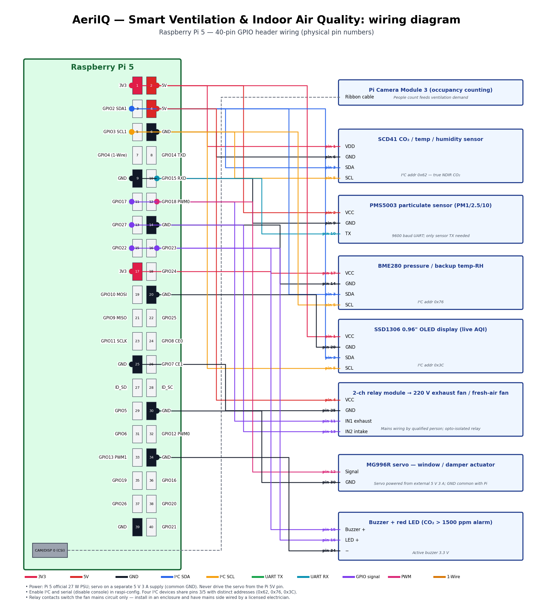

**AeriIQ — AI Smart Ventilation & Indoor Air-Quality System**

Technical Report — components, wiring, code, installation and use

*Prepared by Ibtisam Rafiq \| 13 September 2026*

1\. Status

| **Item**       | **Detail**                                             |
|----------------|--------------------------------------------------------|
| Current status | Starting now — design, wiring and code base complete   |
| Progress       | 15%                                                    |
| Platform       | Raspberry Pi 5 + Camera Module 3 + air-quality sensors |

2\. Problem statement

In the UAE, buildings remain closed for most of the year due to extreme
temperatures and frequent dust storms, leading to poor indoor air
quality and accumulation of pollutants such as CO₂ and particulate
matter. Existing ventilation and HVAC systems operate on fixed settings
without real-time monitoring or adaptive control, resulting in
inefficient energy use and potential health risks for occupants. An
intelligent system is needed that continuously monitors indoor air
conditions and dynamically adjusts ventilation based on data-driven
insights.

3\. System overview

AeriIQ is an AI-based smart ventilation and indoor air-quality
monitoring system for UAE environments. Sensors measure CO₂,
temperature, humidity and particulate matter, a camera counts occupants,
and a lightweight machine-learning model predicts CO₂ fifteen minutes
ahead so that ventilation starts before air quality degrades. The
controller drives exhaust and fresh-air fans and a window/damper
actuator, keeps the window closed when outdoor dust or heat is high, and
enforces minimum run-times to save energy. Readings and decisions are
logged and charted on a dashboard, demonstrating how AI and IoT combine
into an energy-efficient solution supporting UAE sustainability goals.

4\. Components (bill of materials)

| **Component** | **Qty** | **Purpose / notes** |
|----|----|----|
| Raspberry Pi 5 8 GB + PSU + cooler + SD | 1 | Controller, inference, dashboard |
| Camera Module 3 + cable | 1 | Occupancy counting |
| Sensirion SCD41 | 1 | NDIR CO₂/T/RH, I²C 0x62 |
| Plantower PMS5003 + adapter | 1 | PM1/2.5/10, UART |
| BME280 | 1 | Pressure, backup T/RH |
| SSD1306 0.96" OLED | 1 | Live readings |
| 2-channel relay module | 1 | Exhaust + intake fans |
| 12 V fans (demo) or 220 V fans | 2 |  |
| MG996R servo + 5 V 3 A supply | 1 | Window/damper |
| Buzzer + red LED | 1 | CO₂ alarm |
| Ventilated enclosure | 1 |  |

5\. Wiring

| **Component pins** | **Board pins** | **Notes** |
|----|----|----|
| Camera ribbon | CAM/DISP 0 | CSI |
| SCD41 VDD / GND / SDA / SCL | pins 1 / 6 / 3 / 5 | I²C 0x62 |
| PMS5003 VCC / GND / TX | pins 2 / 9 / 10 | UART 9600 |
| BME280 VCC / GND / SDA / SCL | pins 17 / 14 / 3 / 5 | I²C 0x76 |
| OLED VCC / GND / SDA / SCL | pins 1 / 20 / 3 / 5 | I²C 0x3C |
| Relay VCC / GND / IN1 / IN2 | pins 4 / 25 / 11 / 13 | GPIO17 exhaust, GPIO27 intake |
| Servo signal / GND (VCC external) | pins 12 / 30 | GPIO18 PWM |
| Buzzer + / LED + / − | pins 15 / 16 / 34 | GPIO22, GPIO23 |

*Figure 1 — aeriiq_wiring_diagram.png*

6\. Software structure

code/aeriiq/main.py read → count → predict → decide → actuate → log

code/aeriiq/sensors/ scd41.py, pms5003.py, bme280.py

code/aeriiq/vision/occupancy.py YOLOv8n person counting

code/aeriiq/ml/ features.py, train.py (GradientBoosting), predictor.py
(15-min forecast + physics fallback)

code/aeriiq/control/ policy.py (decision rules), actuators.py (relays,
servo, OLED, buzzer)

code/aeriiq/dashboard/ server.py, templates, static (Chart.js)

code/config/settings.yaml, code/models/, code/scripts/,
code/systemd/aeriiq.service

code/tests/test_policy.py (4 tests passing)

7\. How it works

1.  Every 30 s the SCD41, PMS5003 and BME280 are read; every 4th sample
    the camera counts people.

2.  The predictor estimates CO₂ 15 minutes ahead (trained model, or a
    physics fallback of ~8 ppm per person per minute until a model
    exists).

3.  Policy: ≥ 1500 ppm → exhaust + intake + window + alarm; ≥ 1000 ppm
    or forecast ≥ 1500 → fans pre-emptively; PM2.5 ≥ 35 keeps the window
    closed; outdoor heat keeps the window closed.

4.  Fans stay on at least 5 minutes once started (anti-chatter, energy).

5.  Actuators are set, the OLED shows live values, the row is logged and
    the dashboard charts CO₂ against forecast.

6.  After a week, export_training_data.py + train.py produce the
    forecasting model.

8\. Installation

bash code/scripts/setup_pi.sh \# apt, I²C/UART, venv, requirements;
i2cdetect shows 0x3C, 0x62, 0x76

sudo cp code/systemd/aeriiq.service /etc/systemd/system && sudo
systemctl enable --now aeriiq

\# after one week of data:

python code/scripts/export_training_data.py && python -m aeriiq.ml.train

9\. How to use

7.  Open http://\<pi-ip\>:8080 for live values, the ventilation reason
    and the CO₂/forecast chart.

8.  The OLED at the unit shows CO₂, PM2.5, temperature, RH, occupants
    and which actuators are on.

9.  Thresholds, pins and the minimum fan run-time are in
    config/settings.yaml.

10\. How to connect

- Four I²C devices share pins 3/5 with distinct addresses; PMS5003 TX →
  Pi RX (pin 10) only.

- Servo on an external 5 V 3 A supply with common ground.

- Relay contacts switch the fan circuit; mains fans in an enclosure
  wired by a licensed electrician.

11\. Acceptance tests

- CO₂ within ±50 ppm of a reference meter

- Fans start within one sample of crossing 1000 ppm

- Forecast MAE \< 60 ppm

- Window closed when PM2.5 \> 35 µg/m³

- Fan run-time reduced vs fixed schedule with CO₂ \< 1000 ppm 95 % of
  occupied time

12\. Next steps

10. Order hardware; enable I²C/UART; verify the three I²C addresses.

11. Bring up each sensor and the OLED; log to SQLite; verify the
    dashboard.

12. Add occupancy counting; wire the 12 V fans and servo; confirm the
    policy tests pass on real data.

13. Collect one week of classroom data; train the forecast model;
    evaluate MAE.

14. Run a 3-day energy comparison against a fixed schedule; write the
    final report.

13\. Handover items

- Design pack, wiring diagram, code base and tests

- No hardware purchased yet

*Prepared by Ibtisam Rafiq, 13 September 2026.*
