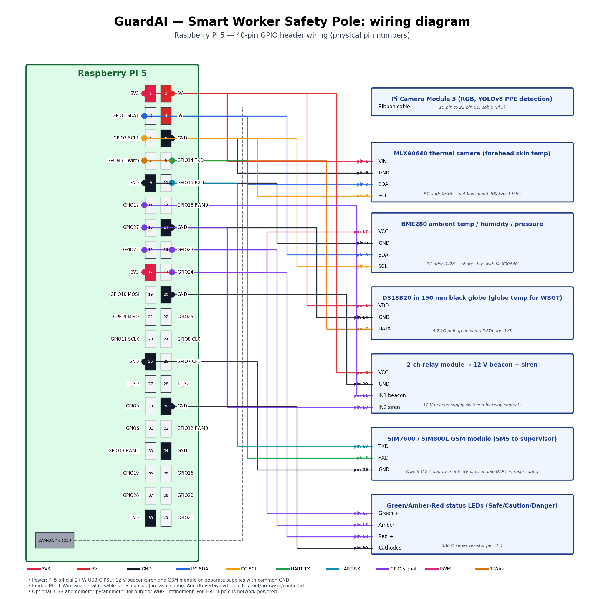

**GuardAI — Smart Worker Safety Pole (PPE Compliance + Contactless
Heat-Stress)**

Technical Report — components, wiring, code, installation and use

*Prepared by Ibtisam Rafiq \| 13 September 2026*

1\. Status

| **Item**       | **Detail**                                           |
|----------------|------------------------------------------------------|
| Current status | Starting now — design, wiring and code base complete |
| Progress       | 15%                                                  |
| Platform       | Raspberry Pi 5 + Camera Module 3 + thermal camera    |

2\. Problem statement

Despite mandatory PPE regulations and heat-work-ban protocols enforced
by the UAE Ministry of Human Resources and Emiratisation, worksite PPE
violations and heat-related incidents remain chronically high across UAE
construction and oil & gas sectors. Current monitoring relies on
periodic human supervision, a reactive, inconsistent and unscalable
approach that cannot detect violations in real time or assess the
physiological heat burden of individual workers. Existing
heat-monitoring solutions require wearable wristbands or body sensors,
creating compliance, hygiene and cost challenges at scale. No
commercially deployed system in the UAE integrates PPE compliance
detection with contactless heat-stress assessment in a single platform.

3\. System overview

GuardAI is a self-contained pole combining computer-vision PPE detection
with a multi-modal heat-stress engine to produce a unified real-time
Worker Safety Score. A Raspberry Pi 5 with a camera runs a fine-tuned
YOLOv8 model to detect hard hat, safety vest and gloves at site entry
points. An MLX90640 thermal camera captures contactless forehead skin
temperature while environmental sensors compute the Wet Bulb Globe
Temperature (WBGT) index. A MediaPipe pose module flags distress
behaviours such as staggering, crouching or prolonged stationary
posture. A weighted fusion engine classifies each worker as Safe,
Caution, Danger or Stop Work. Violations and heat alerts trigger SMS to
supervisors and a relay-controlled beacon, and a live dashboard provides
per-check logs, daily compliance reports and trend analytics aligned to
MOHRE midday-break regulations.

4\. Components (bill of materials)

| **Component** | **Qty** | **Purpose / notes** |
|----|----|----|
| Raspberry Pi 5 8 GB + 27 W PSU + active cooler + 64 GB SD | 1 | Runs YOLOv8n (NCNN) + MediaPipe + sensors |
| Camera Module 3 (wide) + 22-pin CSI cable | 1 | PPE and pose at the gate |
| MLX90640 thermal camera breakout | 1 | Forehead temperature, I²C 0x33 |
| BME280 breakout | 1 | Ambient T, RH, pressure |
| DS18B20 waterproof + 150 mm matte-black copper globe | 1 | Globe temperature; 4.7 kΩ pull-up |
| 2-channel opto-isolated relay module | 1 | 12 V beacon and siren |
| 12 V beacon + siren + 12 V 3 A supply | 1 each | Alert |
| SIM7600 or SIM800L GSM + antenna + SIM | 1 | SMS; own 5 V 2 A supply |
| LEDs green/amber/red + 330 Ω | 3 | Status |
| IP65 enclosure, pole, sunshade | 1 | Keep Pi \< 80 °C |

5\. Wiring

| **Component pins** | **Board pins** | **Notes** |
|----|----|----|
| Camera ribbon | CAM/DISP 0 | CSI |
| MLX90640 VIN / GND / SDA / SCL | pins 1 / 6 / 3 / 5 | 3V3, GND, GPIO2, GPIO3 |
| BME280 VCC / GND / SDA / SCL | pins 17 / 9 / 3 / 5 | I²C 0x76 |
| DS18B20 VDD / GND / DATA | pins 1 / 14 / 7 | GPIO4 1-Wire |
| Relay VCC / GND / IN1 / IN2 | pins 2 / 20 / 11 / 13 | GPIO17 beacon, GPIO27 siren |
| GSM TXD / RXD / GND | pins 10 / 8 / 25 | GPIO15 RX, GPIO14 TX |
| LEDs G / A / R / cathodes | pins 15 / 16 / 18 / 30 | GPIO22/23/24 |

*Figure 1 — guardai_wiring_diagram.png*

6\. Software structure

code/guardai/main.py orchestrator loop + dashboard thread

code/guardai/vision/ camera.py, ppe_detector.py (YOLOv8),
pose_monitor.py (MediaPipe)

code/guardai/sensors/ thermal.py (MLX90640), environment.py (BME280 +
DS18B20), wbgt.py (ISO 7243)

code/guardai/fusion/safety_score.py weighted score → SAFE / CAUTION /
DANGER / STOP WORK

code/guardai/alerts/ sms.py (AT commands), beacon.py (relays + LEDs)

code/guardai/dashboard/ server.py, templates, static

code/config/settings.yaml thresholds, pins, weights, MOHRE midday-break
window

code/scripts/ setup_pi.sh, train_ppe.py, calibrate_thermal.py

code/systemd/guardai.service

code/tests/test_wbgt_and_fusion.py (3 tests passing)

7\. How it works

1.  Each cycle (5 fps) the camera frame goes to the YOLOv8 PPE detector
    and to MediaPipe pose (stagger, crouch, stationary).

2.  The thermal camera reports the mean of the six hottest pixels as
    forehead skin temperature; BME280 and the black-globe DS18B20 give
    ambient T, RH and globe T.

3.  WBGT = 0.7·Tw + 0.2·Tg + 0.1·Ta with Tw from the Stull
    approximation; thresholds 28 / 30 / 32 °C.

4.  heat_score = max(environmental, body); ppe_score = 0.4 per missing
    item; posture_score from pose flags. Score = 0.35·PPE + 0.45·heat +
    0.20·posture; STOP WORK is forced when heat = 1.

5.  The state drives LEDs, beacon (DANGER/STOP) and siren (STOP);
    DANGER/STOP sends an SMS per supervisor with a 5-minute cooldown.

6.  Every check is written to SQLite; the dashboard on port 8080 shows
    live state, recent events and the daily compliance report.

8\. Installation

bash code/scripts/setup_pi.sh \# apt packages, I²C / 1-Wire / UART,
venv, requirements

sudo reboot

i2cdetect -y 1 \# expect 0x33 (MLX90640) and 0x76 (BME280)

python code/scripts/train_ppe.py \# on a laptop/Colab with a PPE dataset
-\> copy best.pt to code/models/ppe_yolov8n.pt

python code/scripts/calibrate_thermal.py \# set
thermal.forehead_offset_c

sudo cp code/systemd/guardai.service /etc/systemd/system && sudo
systemctl enable --now guardai

9\. How to use

7.  Workers pause at the marked spot 1–1.5 m from the pole facing the
    camera.

8.  LEDs show the state; beacon/siren fire on DANGER/STOP WORK;
    supervisors receive SMS.

9.  Open http://\<pi-ip\>:8080 for the live dashboard and
    /api/report/today for the daily report.

10. Edit config/settings.yaml to change thresholds, supervisor numbers,
    fusion weights or pins; restart the service.

10\. How to connect

- Enable I²C, 1-Wire and serial (console disabled) in raspi-config; add
  dtparam=i2c_arm_baudrate=400000.

- GSM module on its own 5 V 2 A supply with common ground; SIM with SMS
  enabled.

- 12 V beacon/siren switched by the relay contacts; never through the
  Pi.

11\. Acceptance tests

- PPE detector ≥ 90 % mAP@0.5 and ≤ 300 ms per frame

- Thermal within ±0.5 °C of a clinical thermometer after calibration

- WBGT within ±1 °C of a commercial meter

- STOP WORK raised within 3 s of a simulated 33 °C input; SMS received

- Daily report totals match the database

12\. Next steps

11. Order the hardware (3–4 weeks lead time) and run setup_pi.sh.

12. Collect and annotate ~1,500 PPE images (Roboflow) and train YOLOv8n;
    export NCNN for the Pi.

13. Bring up sensors one at a time (thermal, BME280, globe) and verify
    WBGT against a reference meter.

14. Integrate pose and fusion; confirm the three unit tests still pass
    with real readings.

15. Assemble the pole and enclosure; run a shaded outdoor trial at the
    school gate; calibrate thermal on 10 subjects.

16. Prepare the final report and presentation from the dashboard logs.

13\. Handover items

- Design pack (this document), wiring diagram, code base and tests

- No hardware purchased yet

Appendix — low-cost variant

Low-cost variant: replace the Pi 5 + Camera Module 3 (≈ AED 620) with an
ESP32-S3 camera board (XIAO ESP32S3 Sense / ESP32-S3-EYE, ≈ AED 60–120)
running a TinyML classifier trained on Edge Impulse for hard hat and
vest only; replace the MLX90640 (≈ AED 300) with an MLX90614
single-point IR sensor (≈ AED 40) read at 30–50 cm; drop the pose module
and send alerts through Wi-Fi (Telegram/WhatsApp) instead of a GSM
module. Total ≈ AED 250–350. The WBGT, fusion and alert logic in this
pack is platform-independent and carries over; the abstract must be
amended to say “lightweight on-device neural network for hard-hat and
vest detection”.

*Prepared by Ibtisam Rafiq, 13 September 2026.*
