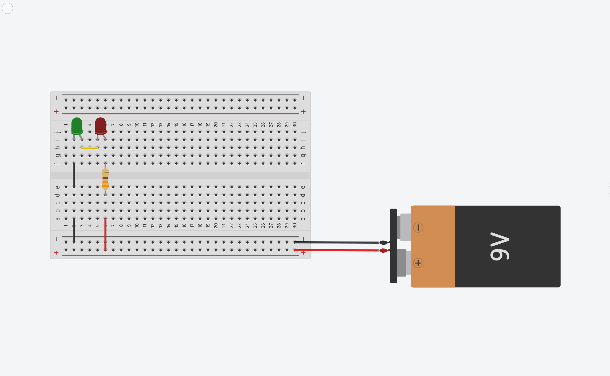

# 01 — LED Interfacing

**Goal:** Understand LED polarity, GPIO output states, and series current limiting.

**Files:** [Teaching sketch](01_LED_Interfacing.ino) · [Original source record](Code.txt)

## Circuit diagram



## TinkerCAD simulation

[Open the LED interfacing circuit](https://www.tinkercad.com/things/0jE23TsG6V8-led-interfacing?sharecode=cB1osCxwd_ja-YpadmkOgm7_vhplCuqtWFejQrOQ1lE)

## Sketch

The original `Code.txt` is marked `N/A`; the `.ino` here is a new Uno starter sketch, not a verbatim conversion. It alternates LEDs on D3 and D5.

## Wiring for this sketch

| Uno connection | Component connection |
|---|---|
| D3 | Green LED anode through its own resistor |
| D5 | Red LED anode through its own resistor |
| GND | Both LED cathodes / circuit return |

The supplied picture appears to show a separate battery-powered LED circuit and does not show an Uno. To run this sketch, use an Uno and rewire as above. Do not connect a 9 V battery to an Uno GPIO pin.

## Key code pattern

```cpp
digitalWrite(GREEN_LED_PIN, HIGH);
digitalWrite(RED_LED_PIN, LOW);
delay(STEP_INTERVAL_MS);
digitalWrite(GREEN_LED_PIN, LOW);
digitalWrite(RED_LED_PIN, HIGH);
```

## Explanation and calculations

`pinMode(..., OUTPUT)` configures each GPIO as an output. `digitalWrite(HIGH)` commands the pin to its logic-high state; `LOW` commands logic low. The delay sets each colour's on-time to 500 ms, so the pair alternates twice per second.

For a bare LED, estimate its series resistor with $R = (V_{supply} - V_f) / I_{LED}$. For example, with a 5 V Uno output, an LED forward voltage near 2 V, and a design current of 5 mA, $R \approx (5-2)/0.005 = 600\ \Omega$; choose a suitable standard value at or above the calculated value and verify brightness. Use the actual LED and board specifications. Never omit the resistor; use one per LED.

## Try next

- Change the interval and describe the resulting blink rate.
- Make both LEDs illuminate together, then alternate again.
- Explain why the LED's anode/cathode orientation matters.