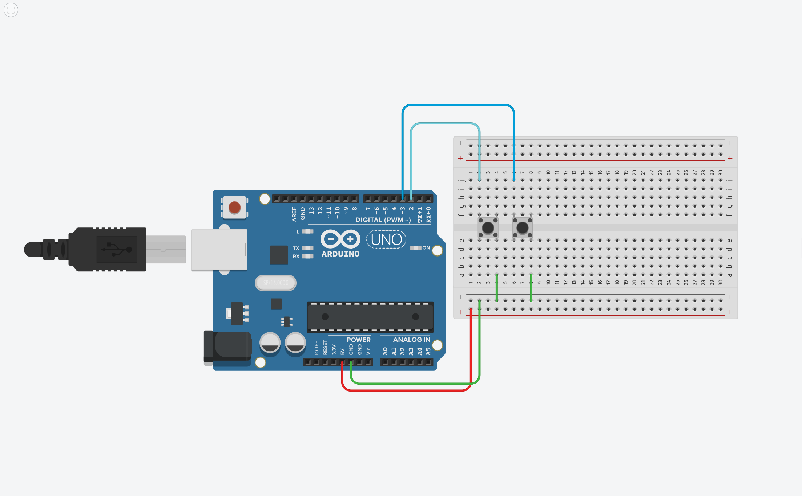

# 02 — Button Interfacing

**Goal:** Read digital inputs and understand internal pull-ups and active-low logic.

**Files:** [Teaching sketch](02_Button_Interfacing.ino) · [Original source](Code.txt)

## Circuit diagram



## TinkerCAD simulation

[Open the button interfacing circuit](https://www.tinkercad.com/things/ereRywZmqTI-button-interfacing?sharecode=q4XndsqV91jkzBPxvPxd6GVIGgEwnBmpIPb3BHotNF4)

## Wiring and pin map

| Uno pin | Connection | Released | Pressed |
|---|---|---:|---:|
| D2 | ON button, other side to GND | HIGH | LOW |
| D3 | OFF button, other side to GND | HIGH | LOW |

`INPUT_PULLUP` enables a weak internal pull-up, so no external pull-up resistor is needed for this simple button-to-ground circuit. Pressing a button connects the input to ground. Do not wire the button from 5 V to the input when using this exact pull-up arrangement.

## Explanation

The sketch samples both inputs and reports clear pressed/released states to Serial at 9600 baud, four times per second. It uses `millis()` to schedule reports rather than blocking with a one-second delay, keeping the loop available for other work. `digitalRead()` returns a logic level; the sketch converts that electrical level into a meaningful Boolean state.

```cpp
const bool onButtonPressed = digitalRead(ON_BUTTON_PIN) == LOW;
Serial.print("ON button pressed: ");
Serial.println(onButtonPressed ? "yes" : "no");
```

Real mechanical buttons can bounce, briefly creating several transitions. This sketch reports a sampled state and does not implement edge detection or debounce; those are follow-up topics before using a button to trigger one-time actions.

## Try next

- Open Serial Monitor at 9600 baud and press each button independently.
- Predict the raw pin level before pressing, then compare it with the named Boolean.
- Add an LED in the next exercise and use a button state to control it.