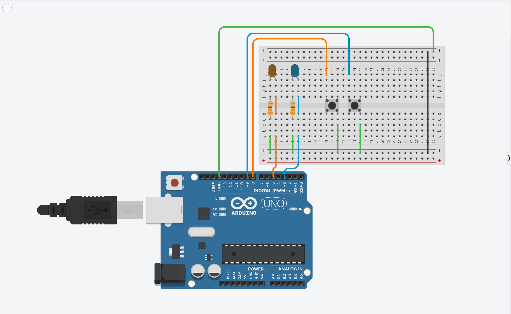

# 03 — Button-Controlled LEDs

**Goal:** Connect digital input states to observable digital outputs.

**Files:** [Teaching sketch](03_Button_Controlled_LED.ino) · [Original source](Code.txt)

## Circuit diagram



## TinkerCAD simulation

[Open the button-controlled LED circuit](https://www.tinkercad.com/things/9LWLfdLh0to-button-controlled-led?sharecode=5lUC6v8SJ1geBLviCCzwcx4W9nxnDrNwuuN5h9Tp_lo)

## Pin map

| Function | Uno pin | Notes |
|---|---:|---|
| Green/GOOD LED | D3 | Series resistor required |
| Red/BAD LED | D5 | Separate series resistor required |
| GOOD button | D9 | Button connects input to GND; internal pull-up enabled |
| BAD button | D8 | Button connects input to GND; internal pull-up enabled |

The diagram should be checked against this pin table before simulation: the sketch preserves the pin assignments in the supplied `Code.txt`. Keep both LED branches current-limited and use a common ground.

## Key code pattern

```cpp
const bool goodPressed = digitalRead(GOOD_BUTTON_PIN) == LOW;
const bool badPressed = digitalRead(BAD_BUTTON_PIN) == LOW;
digitalWrite(GOOD_LED_PIN, goodPressed ? HIGH : LOW);
digitalWrite(BAD_LED_PIN, badPressed ? HIGH : LOW);
```

## Explanation

Each loop reads the two buttons independently. The equality check against `LOW` converts the active-low electrical signal into a positive `buttonPressed` Boolean. The resulting Boolean controls its matching LED. No delay is needed because the program simply mirrors the current button states.

## Try next

- Press both buttons and explain why both LEDs can be on simultaneously.
- Swap the two output assignments in code and predict the result.
- Add debouncing or edge detection if an action should happen once per press rather than remain active while held.