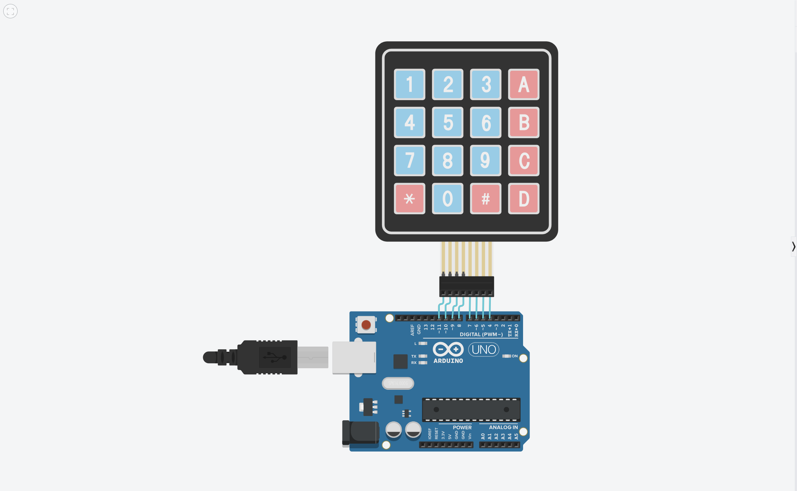

# 04 — 4×4 Keypad Interfacing

**Goal:** Read a matrix keypad and understand row/column scanning and library abstraction.

**Files:** [Teaching sketch](04_4x4_Keypad_Interfacing.ino) · [Original source](Code.txt)

## Circuit diagram



## TinkerCAD simulation

[Open the 4×4 keypad circuit](https://www.tinkercad.com/things/88epWAg2CJn-4x4-keypad-interfacing?sharecode=VD_UD4eTBkRxoJB0yTuWrd9MkfY7-tP8dbMt13p7leI)

## Pin map

| Keypad lead | Uno pin |
|---|---:|
| Row 1–4 | D4, D5, D6, D7 |
| Column 1–4 | D8, D9, D10, D11 |

The keypad has eight matrix connections, not sixteen independent GPIO signals. The `Keypad` library scans rows and columns and returns a character when it detects a key. Confirm the physical keypad's row/column lead order against the TinkerCAD component and this sketch.

## Key code pattern

```cpp
const char key = keypad.getKey();
if (key != NO_KEY) {
	Serial.print("Key pressed: ");
	Serial.println(key);
}
```

## Explanation

`KEY_MAP` assigns a character to each row/column intersection. `makeKeymap()` and the constructor connect that map to the declared pins. `getKey()` returns `NO_KEY` until a new press is detected; the sketch then prints the character to Serial at 9600 baud. The empty numeric-key conditional in the supplied sketch did not implement any behavior, so the teaching sketch now reports every key consistently.

## Library and extension

Use the Keypad library available in the selected Arduino/TinkerCAD environment. Extend this example by accepting only digits, accumulating a passcode, and clearing it on `*`; do not store real credentials in a public teaching sketch.