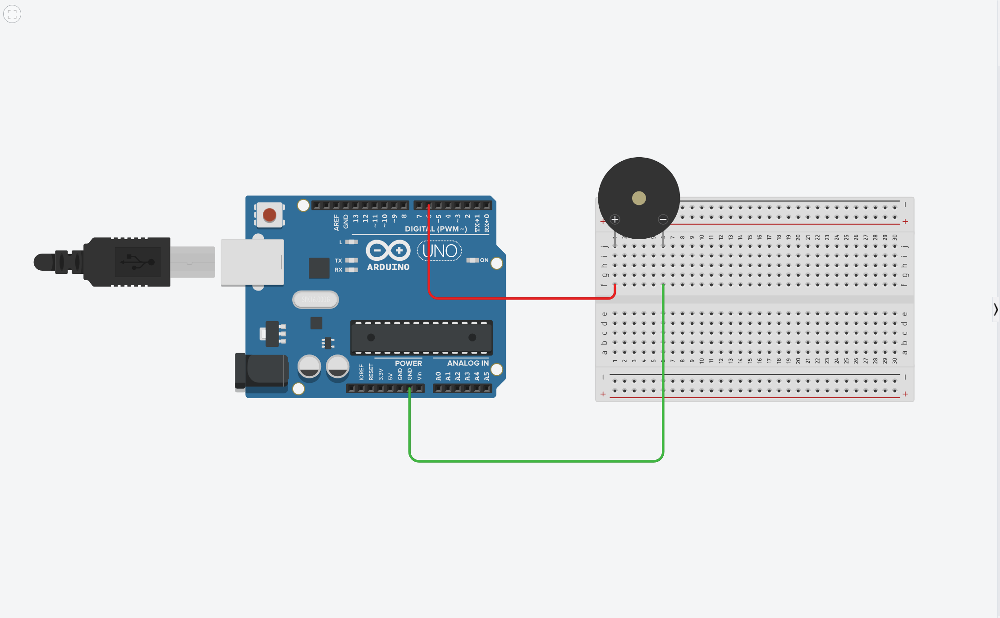

# 05 — Buzzer Interfacing with PWM

**Goal:** Observe PWM duty-cycle changes and distinguish output level from tone frequency.

**Files:** [Teaching sketch](05_Buzzer_Interfacing_PWM.ino) · [Original source](Code.txt)

## Circuit diagram



## TinkerCAD simulation

[Open the buzzer PWM circuit](https://www.tinkercad.com/things/fcNlCTTIRhf-buzzer-interfacing-pwm?sharecode=nZh9f4peSA7BCmLvmXxTewymqCG1EwDfGoCq6hK3riE)

## Wiring

| Uno connection | Buzzer connection |
|---|---|
| D6 (PWM) | Positive/control terminal |
| GND | Negative terminal / common return |

Use a buzzer rated for the chosen supply and pin drive. If the device draws more current than the GPIO rating permits, use a suitable transistor driver; do not power a high-current load directly from a pin.

## Key code pattern

```cpp
for (int duty = 0; duty <= 255; duty++) {
	analogWrite(BUZZER_PIN, duty);
	delay(STEP_DELAY_MS);
}
```

## Explanation

On an Uno, `analogWrite()` accepts a duty value from 0 to 255. The sketch ramps from 0 to 255 and back, printing each duty value over Serial. PWM rapidly switches the output; duty cycle changes the proportion of each period that is HIGH. It does **not** change the PWM frequency. A passive piezo buzzer's audible pitch is controlled by frequency (for example with `tone()`), while an active buzzer contains its own oscillator and may respond differently to PWM.

The loop is intentionally blocking to make the ramp easy to observe. For a responsive multi-input system, replace the delays with `millis()`-based timing.

## Try next

- Compare the changing duty value with the sound/volume in the simulator.
- Use `tone(BUZZER_PIN, frequencyHz)` to explore pitch with a passive buzzer.
- Explain why duty cycle and frequency are separate PWM properties.