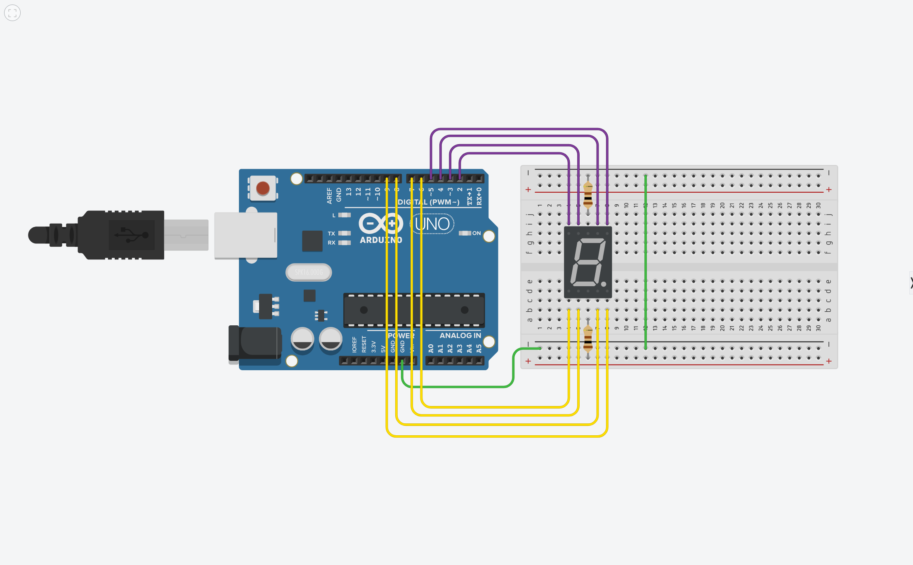

# 06 — 7-Segment Display Interfacing

**Goal:** Map GPIO outputs to labelled display segments and understand current limiting.

**Files:** [Teaching sketch](06_7_Segment_Display.ino) · [Original source](Code.txt)

## Circuit diagram



## TinkerCAD simulation

[Open the seven-segment display circuit](https://www.tinkercad.com/things/8VipHyKr9po-7-segment-display-interfacing?sharecode=-V-sPeApqYiHrkFJZMW_f-Qn3iHLoNIKTQrbgxOr20g)

## Pin map and segment pattern

| Segment | Uno pin | Letter A state |
|---|---:|---|
| a | D4 | ON |
| b | D5 | ON |
| c | D8 | ON |
| d | D7 | OFF |
| e | D6 | ON |
| f | D3 | ON |
| g | D2 | ON |
| decimal point | D9 | OFF |

The sketch assumes a **common-cathode** display. A common-anode part needs inverted output logic. Verify the exact display pinout and type before wiring.

## Key code pattern

```cpp
digitalWrite(SEGMENT_A_PIN, HIGH);
digitalWrite(SEGMENT_B_PIN, HIGH);
digitalWrite(SEGMENT_C_PIN, HIGH);
digitalWrite(SEGMENT_D_PIN, LOW);
digitalWrite(SEGMENT_E_PIN, HIGH);
digitalWrite(SEGMENT_F_PIN, HIGH);
digitalWrite(SEGMENT_G_PIN, HIGH);
```

## Current limiting

Use a separate series resistor for each segment. A single resistor on a common pin makes segment current and brightness vary with the number of illuminated segments. As an illustrative estimate, a 5 V output, approximately 2 V LED forward drop, and 5 mA segment current gives $R \approx (5-2)/0.005 = 600\ \Omega$. Select a suitable standard value and verify actual component ratings and GPIO limits.

The supplied diagram appears to show fewer resistors than the number of driven segments. Treat it as a conceptual wiring reference; add a resistor to each segment line before powering a physical build.

## Explanation

Each display segment is an LED. The function `displayLetterA()` turns on segments a, b, c, e, f, and g and leaves d and the decimal point off. The loop stays empty because the static pattern is set once in `setup()`.

## Try next

- Create a digit lookup table and display 0–9.
- Identify common-anode versus common-cathode logic from the component datasheet.
- Explain why multiplexed multi-digit displays need a different refresh strategy.