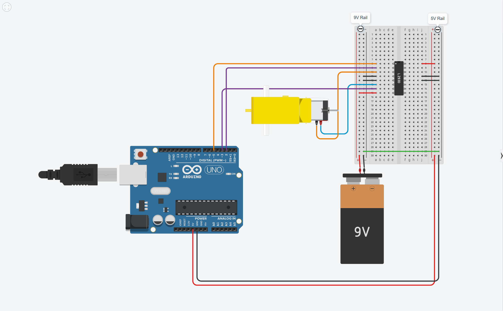

# 07 — Single DC Motor with an H-Bridge

**Goal:** Control motor direction through a driver IC instead of drawing motor current from GPIO.

**Files:** [Teaching sketch](07_Single_Motor_H_Bridge.ino) · [Original source](Code.txt)

## Circuit diagram



## TinkerCAD simulation

[Open the single-motor H-bridge circuit](https://www.tinkercad.com/things/e5qcWvTy3Hr-single-motor-h-bridge?sharecode=w7th6b7Ad2_U12Ri2Y3tVRvzMLrXveengqyR_wwS_Og)

## Uno control pins

| Signal | Uno pin | Purpose |
|---|---:|---|
| Enable | D5 | Enables the driver; can support PWM speed control on this board |
| IN1 | D2 | Direction input 1 |
| IN2 | D3 | Direction input 2 |

For an L293D, check the exact datasheet pinout: logic supply, motor supply, enable, input, output, and ground pins must be wired correctly. The diagram shows separate 5 V logic and 9 V motor rails, with an external 9 V battery. Both supplies need a shared ground reference. The motor connects to the H-bridge outputs, never directly to an Uno pin.

## Critical supply note

A rectangular PP3 9 V battery is usually a poor motor supply because its available current is limited and its voltage can sag. Choose a motor supply within both the motor and driver ratings and capable of the motor's startup/stall current. Verify the driver voltage drop and thermal limits. Do not copy the diagram's battery choice to physical hardware without checking those ratings.

## Key code pattern

```cpp
digitalWrite(MOTOR_INPUT_1_PIN, HIGH);
digitalWrite(MOTOR_INPUT_2_PIN, LOW);  // One direction
// Swap the two logic states to reverse direction.
```

## Explanation

The enable is held HIGH. `IN1=HIGH, IN2=LOW` drives one direction; reversing the pair reverses motor polarity. Both inputs LOW stop the drive in this simple program. Direction labels depend on motor wiring and are not absolute. The delays make the sequence easy to observe but block other work while running.

## Try next

- Add PWM to the enable pin to vary speed, while remaining within driver and motor limits.
- Add a safe stop button and test its behavior during both directions.
- Explain what should happen if the controller resets while the driver is enabled.