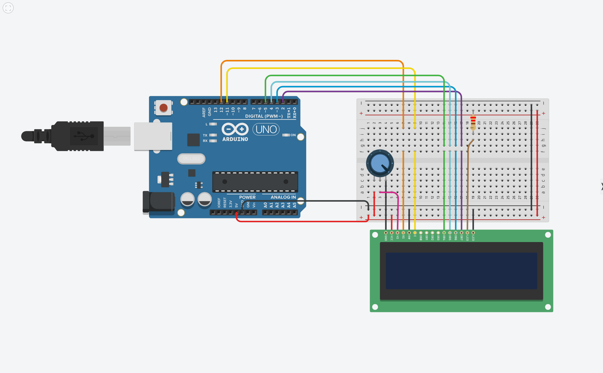

# 08 — Parallel 16×2 LCD

**Goal:** Display text using an HD44780-compatible character LCD and a four-bit data bus.

**Files:** [Teaching sketch](08_Parallel_16x2_LCD.ino) · [Original source](Code.txt)

## Circuit diagram



## TinkerCAD simulation

[Open the parallel LCD circuit](https://www.tinkercad.com/things/aJnlQH9F4If-parallel-16x2-display-interfacing?sharecode=m9WENRCHO9F2zTqd7yDp1POnhoiyCf7SQMjxc7R6w1w)

## Pin map

| LCD signal | Uno pin / connection |
|---|---|
| RS | D12 |
| E | D11 |
| D4, D5, D6, D7 | D5, D4, D3, D2 respectively |
| R/W | GND (write-only) |
| VSS / VDD | GND / compatible supply per module specification |
| VO | Potentiometer wiper for contrast |

The `LiquidCrystal` constructor order is RS, enable, D4, D5, D6, D7. LCD pin names are not the same as Arduino pin numbers; follow the diagram and verify the component pinout. Use an appropriate backlight resistor or module circuitry as required by the display.

## Key code pattern

```cpp
lcd.begin(16, 2);
lcd.setCursor(0, 0);
lcd.print("EEE4015 LCD");
lcd.setCursor(0, 1);
lcd.print("Seconds: ");
lcd.print(secondsSinceStart);
```

## Explanation

`lcd.begin(16, 2)` configures a 16-column, two-row display. The first line is a fixed label; the second line updates a seconds counter. LCD row indexes start at zero. The sketch adds spaces after the value to erase old digits when the displayed number gets shorter.

## Try next

- Show a sensor reading with units and a short status message.
- Explain why the contrast potentiometer changes visibility but not the text data.
- Compare the number of GPIO wires with the I2C display in example 09.