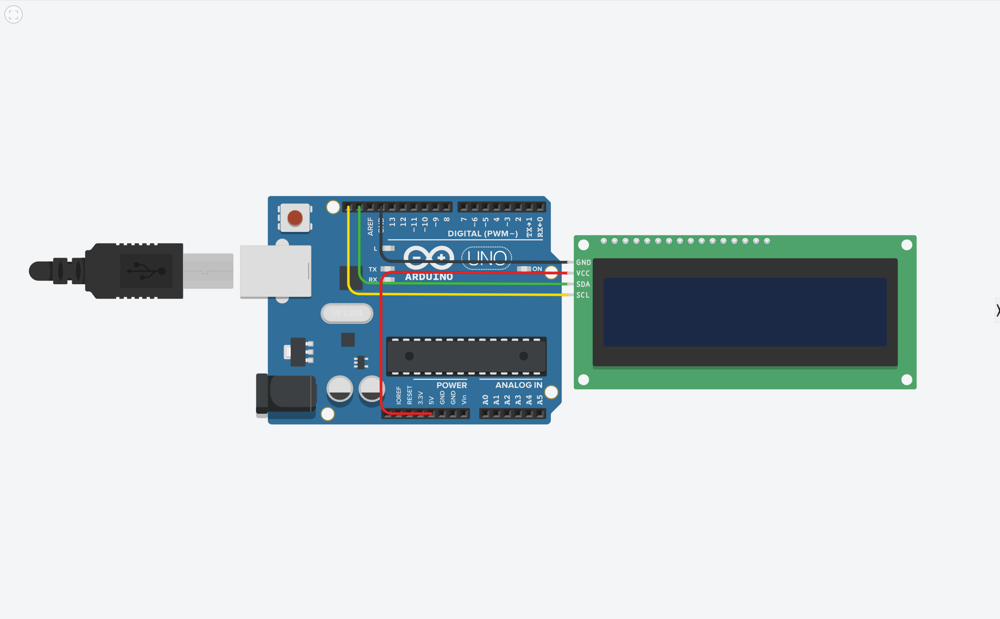

# 09 — I2C 16×2 LCD

**Goal:** Use an I2C backpack to reduce the number of controller signal wires needed by a character LCD.

**Files:** [Teaching sketch](09_I2C_16x2_LCD.ino) · [Original source](Code.txt)

## Circuit diagram



## TinkerCAD simulation

[Open the I2C LCD circuit](https://www.tinkercad.com/things/icTVBIfsx9H-i2c-lcd-display?sharecode=oYVtdNStlQm9gI9KabqkEwKwwP6R5AIQ31sE6nYpA0E)

## Uno R3 connections

| LCD backpack | Uno R3 |
|---|---|
| GND | GND |
| VCC | Compatible supply specified for the module |
| SDA | A4 / SDA |
| SCL | A5 / SCL |

The exact supply and pull-up voltage are module-dependent. Check the backpack documentation, especially before connecting it to a 3.3 V ESP32. Some 5 V backpacks pull SDA/SCL up to 5 V and require level shifting for 3.3 V controllers.

## Key code pattern

```cpp
Adafruit_LiquidCrystal lcd(0);  // Address/index used by this simulator
lcd.begin(16, 2);
lcd.setBacklight(1);
lcd.setCursor(0, 0);
lcd.print("EEE4015");
```

## Library and address

The source sketch uses `Adafruit_LiquidCrystal` and constructor argument `0`, as required by the supplied TinkerCAD model. This is not a universal physical I2C address. For real hardware, install a compatible library and use the backpack's actual address; verify the library's constructor semantics.

## Explanation

`begin(16, 2)` configures the display, `setBacklight(1)` enables its backlight using this library's API, and `setCursor(column, row)` selects a text position. The message is printed once because the LCD retains its displayed characters.

## Try next

- Compare wiring count with the parallel LCD in example 08.
- Display a changing reading without clearing the whole display every loop.
- Identify SDA/SCL and explain that I2C devices share a bus but use addresses.