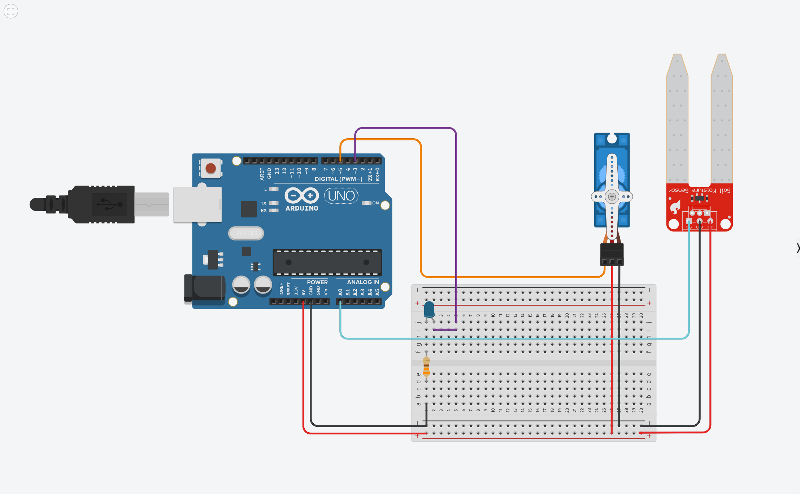

# 10 — Moisture Sensor Controlled Servo

**Goal:** Read an analogue sensor and use a threshold to select a servo position and status LED state.

**Files:** [Teaching sketch](10_Moisture_Sensor_Servo.ino) · [Original source](Code.txt)

## Circuit diagram



## TinkerCAD simulation

[Open the moisture-sensor servo circuit](https://www.tinkercad.com/things/9ZBKxCa8CKA-moisture-sensor-controlled-servo?sharecode=8fhUROTXGvUh2j8pHiuWuGaIcoHlkBh1_4gmBuTPD3I)

## Pin map

| Device signal | Uno pin |
|---|---:|
| Sensor analogue output | A0 |
| Status LED | D3, with series resistor |
| Servo control signal | D5 |
| Sensor/servo ground | GND reference, as required by the supply arrangement |

The diagram's sensor VCC and servo supply must match each module's specifications. A servo can draw more current than the Uno regulator can provide; use a suitable external low-voltage supply when needed and connect grounds as required. Never power a servo from a GPIO pin.

## Key code pattern

```cpp
const int moistureRaw = analogRead(MOISTURE_SENSOR_PIN);
if (moistureRaw > MOISTURE_THRESHOLD + HYSTERESIS_COUNTS) {
	readingAboveThreshold = true;
} else if (moistureRaw < MOISTURE_THRESHOLD - HYSTERESIS_COUNTS) {
	readingAboveThreshold = false;
}
```

## Calibration and threshold

An Uno analogue input returns a nominal 10-bit code in the range 0–1023. The original code's `100` threshold is not a universal soil-moisture value. Record readings in dry and damp conditions, choose a threshold based on those observations, and document which direction corresponds to wetter soil for the exact sensor module.

The teaching sketch keeps the original response mapping: readings above the threshold move the servo to 10 degrees and switch the LED off; readings below it move to 120 degrees and switch the LED on. A 10-count hysteresis band prevents repeated toggling at the boundary. The threshold direction and angles are demonstration choices, not agronomic recommendations.

## Explanation

The servo library generates the control pulse; `write()` requests a position. The sketch samples at 4 Hz using `millis()`, reports raw readings to Serial, and holds the previous state within the hysteresis band.

## Try next

- Log calibrated readings and select a justified threshold.
- Test values below, inside, and above the hysteresis band.
- Add a defined fault response for a disconnected or implausible sensor reading.