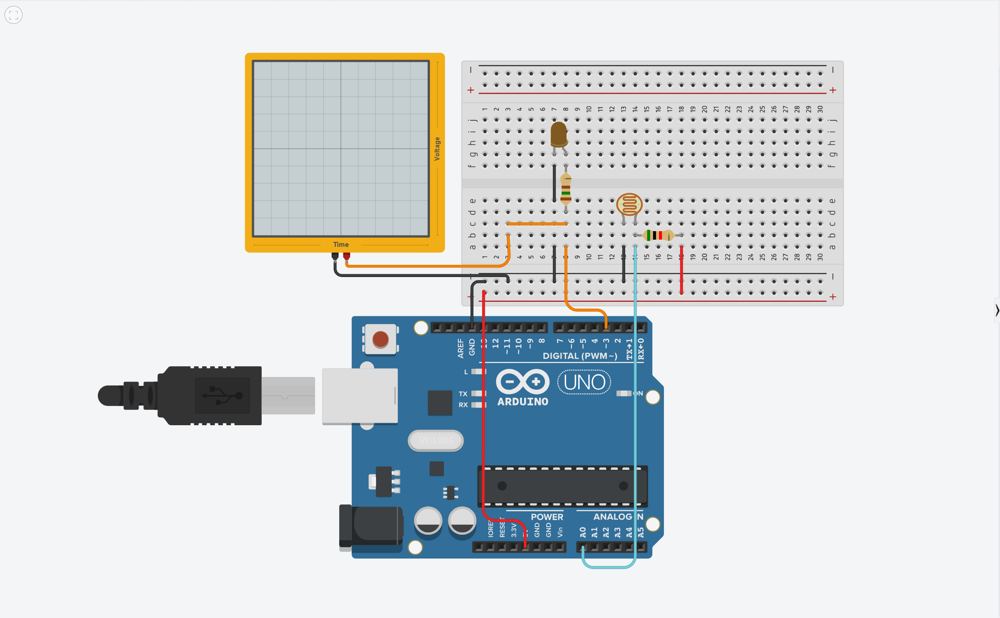

# 11 — LDR-Controlled PWM

**Goal:** Convert a light-dependent resistor voltage-divider reading into PWM brightness for an LED.

**Files:** [Teaching sketch](11_LDR_Controlled_PWM.ino) · [Original source](Code.txt)

## Circuit diagram



## TinkerCAD simulation

[Open the LDR-controlled PWM circuit](https://www.tinkercad.com/things/kD4vW2kdp7H-ldr-controlled-pwm?sharecode=yVU1JPkegVmQbrdxeehnA2ZpNqdMDCTT0NiX4nznteY)

## Pin map and source correction

| Signal | Uno pin |
|---|---:|
| LDR voltage-divider midpoint | A5 in the supplied diagram |
| LED control | D3 (PWM), through a series resistor |
| Divider supply/reference | 5 V and GND as shown |

The original `Code.txt` reads `A0`, but the supplied diagram appears to connect the divider midpoint to `A5`. The `.ino` follows the diagram and uses A5. Either move the signal wire to A0 or change `LDR_PIN` if the TinkerCAD circuit is wired differently.

## Key code pattern

```cpp
const int ldrRaw = analogRead(LDR_PIN);
const int brightness = constrain(map(ldrRaw, 0, 1023, 0, 255), 0, 255);
analogWrite(LED_PIN, brightness);
```

## Measurement and mapping

The LDR and fixed resistor form a voltage divider. For an LDR on the supply side and a fixed resistor on the ground side, the midpoint voltage is approximately $V_{out} = V_{in} \times R_{fixed}/(R_{LDR}+R_{fixed})$; reversing their positions reverses the light response. The Uno ADC converts the input to a nominal code from 0 to 1023. PWM uses an 8-bit duty command from 0 to 255, so the sketch maps the ADC range into the PWM range and constrains the result.

The mapping assumes ADC values rise with light. Check this in the simulator. If they fall as light increases, reverse the output endpoints (for example map 0–1023 to 255–0). For better control, measure dark and bright endpoint readings and map those calibrated values instead of assuming the full ADC range.

## Explanation and safety

`analogWrite()` on a supported Uno PWM pin produces a digital pulse train whose duty cycle changes perceived LED brightness. It is not a true analogue voltage. Use a series resistor for a bare LED and stay within the board's documented pin-current limits.

## Try next

- Print and record dark/bright ADC values, then calibrate the map endpoints.
- Add a smoothing filter if the LED visibly flickers due to noisy readings.
- Add hysteresis if the output is later used as an on/off threshold control.