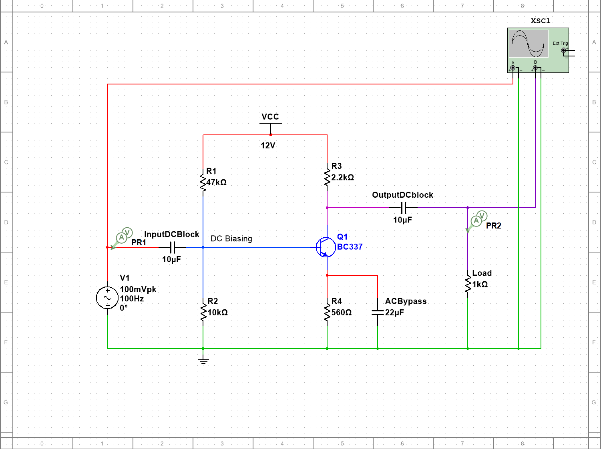
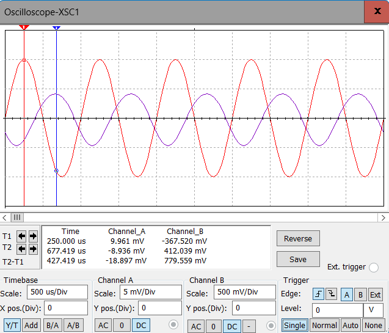
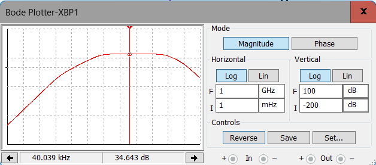

# BC337 Common-Emitter Amplifier

This folder contains a Multisim common-emitter (CE) voltage amplifier built around an NPN BC337 transistor. The stage uses a voltage-divider base bias, an emitter resistor for DC stability, capacitors for AC coupling and emitter bypass, and an 820 ohm output load.

## Project files

- `CE Amplifier BC337.ms14` - Multisim design.
- `CE Amplifier BC337.ms14 (Security copy)` - Multisim security copy.
- [Diagram.png](Diagram.png) - circuit schematic and 1 kHz probe readings.
- [Crumb Diagram.png](Crumb%20Diagram.png) - physical breadboard implementation from the CRUMB 3D simulator.
- [CE Amplifier BC337.cru](CE%20Amplifier%20BC337.cru) - CRUMB 3D circuit/save file for the hardware implementation.
- [Scope PNG/](Scope%20PNG/) - frequency-by-frequency hardware oscilloscope captures from 50 Hz to 10 MHz.
- [Oscilloscope.png](Oscilloscope.png) - time-domain input and output.
- [BodePlotter.png](BodePlotter.png) - voltage-gain magnitude response.
- [Voltage Current Plot.xlsx](Voltage%20Current%20Plot.xlsx) - updated AC-sweep input/output voltage and current data.
- [Power Plot.xlsx](Power%20Plot.xlsx) - updated AC-sweep source and load power data.

## Circuit schematic



## Physical implementation


The CRUMB 3D view records the physical layout corresponding to the Multisim circuit: a BC337 stage, voltage-divider bias resistors, collector and emitter resistors, input/output coupling capacitors, emitter bypass capacitor, and the output load. The breadboard assembly should be compared with the schematic rather than used as a wiring-only reproduction, since component placement and lead routing do not affect the intended circuit topology but do affect noise and high-frequency behaviour.

Use [CE Amplifier BC337.cru](CE%20Amplifier%20BC337.cru) to reopen the CRUMB 3D implementation. The hardware evidence also includes the individual images in [Scope PNG/](Scope%20PNG/), covering:

```text
50 Hz, 100 Hz, 200 Hz, 500 Hz, 1 kHz, 2 kHz, 5 kHz,
10 kHz, 50 kHz, 100 kHz, 200 kHz, 500 kHz,
1 MHz, 2 MHz, 5 MHz, 10 MHz
```

In each capture, Channel 1 is the yellow input waveform and Channel 2 is the magenta output waveform. The output remains inverted relative to the input. The capture sequence shows strong low-frequency attenuation below the pass band, a nearly flat midband response, and increasing high-frequency roll-off towards 10 MHz.

## Circuit at a glance

| Reference / label | Value | Purpose |
|---|---:|---|
| VCC | 12 V DC | Collector supply |
| Q1 | BC337 NPN | Common-emitter amplifying device |
| R1 | 47 kOhm | Upper base-bias divider resistor |
| R2 | 10 kOhm | Lower base-bias divider resistor |
| R3 | 2.2 kOhm | Collector resistor; converts collector-current changes to voltage |
| R4 | 560 ohm | Emitter resistor; stabilises the DC operating point |
| InputDCBlock | 10 uF | Couples the AC source to the base while blocking source DC |
| ACBYPASS | 22 uF | Bypasses R4 for AC to increase voltage gain |
| OutputDCBlock | 3.3 uF | Couples the collector signal to the load while blocking collector DC |
| Load | 820 ohm | Output load connected after the coupling capacitor |
| V1 | 10 mV peak, 1 kHz | Input test signal; 20 mV peak-to-peak |

The input signal is applied to the base through the 10 uF capacitor. A small increase in base voltage increases collector current; the larger current causes a larger voltage drop across R3, so the collector voltage falls. The output is therefore amplified and inverted: a common-emitter stage has approximately 180 degrees of phase inversion in its midband.

R4 provides negative feedback for DC bias: if current rises, the emitter voltage rises, reducing base-emitter voltage and opposing the current increase. The 22 uF capacitor bypasses R4 for AC over much of the operating band, reducing AC feedback and increasing gain without removing the DC stabilisation.

## How to choose the bias resistors

The following is a first-pass design method. The BC337 current gain (`beta`, or `hFE`) varies between devices and with collector current, so use the transistor model or datasheet value appropriate to the design and verify the resulting operating point in Multisim.

### 1. Choose a quiescent current and emitter voltage

For this example, aim for a collector current near 2 mA and an emitter voltage near 1.2 V. An emitter voltage around 10% of the supply is a useful starting point: it gives the emitter resistor room to stabilise current while leaving voltage headroom for the output signal.

The emitter resistor estimate is:

```text
RE = VE / IE
   = 1.2 V / 2 mA
   = 600 ohm
```

The schematic uses the nearby standard value 560 ohm. The actual current is then determined by the complete bias network, not by this estimate alone.

### 2. Set the base voltage

For a silicon NPN transistor, use approximately 0.7 V for the base-emitter voltage at this current:

```text
VB = VE + VBE
   = 1.2 V + 0.7 V
   = 1.9 V
```

Choose the divider current through R2 to be about ten times the expected base current. This reduces the amount that base current loads the divider. With a design estimate of beta = 100 and IC = 2 mA:

```text
IB = IC / beta = 2 mA / 100 = 20 uA
IR2 target = 10 * IB = 200 uA
R2 = VB / IR2 = 1.9 V / 200 uA = 9.5 kOhm
```

Choose the standard value `R2 = 10 kOhm`. Current through R1 must supply both the R2 current and the transistor base current:

```text
IR1 = IR2 + IB = 200 uA + 20 uA = 220 uA
R1 = (VCC - VB) / IR1
   = (12 V - 1.9 V) / 220 uA
   = 45.9 kOhm
```

Choose the standard value `R1 = 47 kOhm`. A common mistake is to calculate R1 using only the R2 current. Including base current gives a better first estimate of the loaded divider.

### 3. Check the divider with its Thevenin equivalent

The unloaded divider voltage is not the final base voltage because the transistor draws base current. Replace R1 and R2, as seen from the base, with a Thevenin source:

```text
VTH = VCC * R2 / (R1 + R2)
    = 12 * 10 / (47 + 10)
    = 2.105 V

RTH = R1 || R2
    = (47 kOhm * 10 kOhm) / (47 kOhm + 10 kOhm)
    = 8.246 kOhm
```

Using beta = 100, VBE = 0.70 V, and RE = 560 ohm, estimate base current with:

```text
IB = (VTH - VBE) / (RTH + (beta + 1) * RE)
   = (2.105 - 0.70) / (8.246 kOhm + 101 * 560 ohm)
   = 21.7 uA

IC = beta * IB = 2.17 mA
IE = (beta + 1) * IB = 2.19 mA
VB = VTH - IB * RTH = 1.93 V
VE = IE * RE = 1.23 V
```

These are approximate hand calculations. A real transistor model, temperature, and device-to-device beta variation will change the exact values. If the simulated collector voltage is near 0 V or near 12 V, the transistor is not biased in the intended active region; revisit the divider, R4, and R3 values.

## Choosing the collector resistor

The collector voltage is approximately:

```text
VC = VCC - IC * RC
VCE = VC - VE
```

For a roughly symmetrical output swing, place the collector operating voltage near the middle of the available range between the supply and the emitter-plus-saturation voltage. With VE about 1.2 V and VCE(sat) about 0.2 V, a rough target is:

```text
VC(target) ~= (VCC + VE + VCE(sat)) / 2
           ~= (12 + 1.2 + 0.2) / 2
           ~= 6.7 V

RC ~= (VCC - VC(target)) / IC
   ~= (12 - 6.7) / 2.17 mA
   ~= 2.44 kOhm
```

The schematic uses `R3 = 2.2 kOhm`, a nearby standard value. With the estimated current:

```text
VC ~= 12 V - (2.17 mA * 2.2 kOhm) ~= 7.23 V
VCE ~= 7.23 V - 1.23 V ~= 6.00 V
```

This leaves useful voltage headroom in both directions. The 820 ohm load is isolated from DC by the output capacitor, so it does not set the DC collector current.

## Resistor power checks

For each resistor, calculate its dissipation and choose a rated part with comfortable margin. A common rule is to use a rating at least two or three times the calculated dissipation; also check the circuit's worst-case supply and current.

```text
PR3 = IC^2 * R3
    ~= (2.17 mA)^2 * 2.2 kOhm
    ~= 10.4 mW

PR4 = IE^2 * R4
    ~= (2.19 mA)^2 * 560 ohm
    ~= 2.7 mW
```

These are low dissipations for standard 1/4 W resistors. R1 and R2 also dissipate only a few milliwatts at 12 V.

## Impedance and gain calculations

Impedance is generally AC-dependent in this circuit because capacitors have frequency-dependent impedance. For a resistor, `Z = R`. For a capacitor:

```text
ZC = 1 / (j * 2 * pi * f * C)
|ZC| = 1 / (2 * pi * f * C)
```

The magnitude `|ZC|` is the capacitive reactance. It decreases as frequency or capacitance increases.

### DC and AC input impedance

At DC, the coupling capacitors are open circuits. The base is biased by R1 and R2, and the transistor's base current loads that divider. For small-signal AC, the supply rail is AC ground, so the bias resistors appear as:

```text
RBIAS = R1 || R2 = 8.246 kOhm
```

An approximate small-signal model uses:

```text
VT ~= 25.85 mV at room temperature
gm = IC / VT
re ~= VT / IE
rpi ~= beta / gm
```

At the estimated operating point and beta = 100:

```text
gm ~= 2.17 mA / 25.85 mV ~= 0.084 S
re ~= 25.85 mV / 2.19 mA ~= 11.8 ohm
rpi ~= 100 / 0.084 ~= 1.19 kOhm
```

Let `ZE` be the AC impedance from the emitter to ground, including R4 and the bypass capacitor. Looking into the base of the transistor is approximately:

```text
ZIN,base ~= rpi + (beta + 1) * ZE
ZIN,amplifier ~= R1 || R2 || ZIN,base
```

When the bypass capacitor is effective, `ZE` is small. For the simplified midband estimate with beta = 100 and an ideal short for the bypass capacitor:

```text
ZIN,base ~= rpi ~= 1.19 kOhm
ZIN,amplifier ~= 8.246 kOhm || 1.19 kOhm ~= 1.04 kOhm
```

This is an estimate, not a fixed input resistance. It depends on transistor beta, frequency, signal-source resistance, and how completely R4 is bypassed. The schematic probe annotation shows 7.07 mV RMS and 2.75 uA RMS at the input, giving an apparent measured value:

```text
ZIN,apparent ~= VIN / IIN
             = 7.07 mV / 2.75 uA
             ~= 2.57 kOhm at 1 kHz
```

Use the probe value as the result for that Multisim run and probe location. A physical measurement should use a known source impedance and avoid treating a loaded input voltage as an open-circuit source voltage.

### Output impedance and load effect

Looking into the collector with the input signal set to zero, the output resistance is approximately:

```text
ROUT,collector ~= R3 || ro
```

Here `ro` is the transistor's small-signal collector output resistance. If `ro` is much larger than R3, then `ROUT` is about 2.2 kOhm. At the output terminal, the 3.3 uF capacitor is in series with this source resistance; with the load removed, its impedance must also be included. At 1 kHz:

```text
|XCout| = 1 / (2 * pi * 1 kHz * 3.3 uF) ~= 48.2 ohm
```

Because 48.2 ohm is small compared with 2.2 kOhm, the output impedance magnitude is still approximately 2.2 kOhm at 1 kHz. This is not a low-impedance power output stage.

When the 820 ohm load is connected, it substantially reduces voltage gain. In the midband approximation, where the output capacitor is treated as a short and transistor `ro` is ignored:

```text
RAC = R3 || RL
    = 2.2 kOhm || 820 ohm
    ~= 597 ohm
```

The load does not equal the output impedance. The load is the external resistance; the output impedance describes the amplifier's ability to hold its output voltage as the load changes.

### Midband voltage gain

With the emitter fully bypassed, an approximate loaded common-emitter gain is:

```text
Av ~= -gm * (R3 || RL)
   ~= -0.084 * 597
   ~= -50 V/V
```

The minus sign indicates phase inversion. The gain magnitude in decibels is:

```text
Av(dB) = 20 * log10(|Av|)
```

For 50 V/V, this is about 34.0 dB. This simple estimate assumes a fully effective emitter bypass, ignores transistor output resistance, and treats the output coupling capacitor as a short. The actual gain at 1 kHz is lower because the bypass capacitor has finite reactance and the transistor model is not ideal.

## Capacitors and low-frequency response

The three capacitors serve different purposes:

- The 10 uF input capacitor blocks DC from the signal generator. Its corner frequency depends on source resistance plus amplifier input resistance.
- The 22 uF emitter capacitor bypasses R4 for AC. Its corner depends on the resistance seen looking into the emitter, not just on R4 alone.
- The 3.3 uF output capacitor blocks collector DC from the 820 ohm load. Its corner depends on amplifier output resistance plus load resistance.

For a simple series-capacitor high-pass network:

```text
fC = 1 / (2 * pi * C * Rseen)
```

For input and output coupling, the usual first estimates are:

```text
fCin ~= 1 / (2 * pi * Cin * (Rsource + Zin))
fCout ~= 1 / (2 * pi * Cout * (Rout + RL))
```

Using `Rout ~= 2.2 kOhm` and `RL = 820 ohm` gives:

```text
fCout ~= 1 / (2 * pi * 3.3 uF * (2.2 kOhm + 820 ohm))
      ~= 16 Hz
```

The emitter bypass pole is more involved. A first-order estimate is:

```text
fCbypass ~= 1 / (2 * pi * Cbypass * (R4 || Rlooking_into_emitter))
```

The resistance looking into the emitter depends on the base's AC source impedance and transistor beta. Therefore, do not calculate this pole using R4 alone and assume it is the amplifier's exact low-frequency cutoff. At 1 kHz, the capacitor reactances are:

| Capacitor | Reactance at 1 kHz | Interpretation |
|---|---:|---|
| 10 uF input | 15.9 ohm | Small compared with the estimated input impedance |
| 22 uF bypass | 7.23 ohm | Much smaller than 560 ohm, but not zero compared with the transistor's emitter resistance |
| 3.3 uF output | 48.2 ohm | Small compared with the 820 ohm load and 2.2 kOhm source resistance |

To determine the actual low-frequency cutoff, sweep the Bode plot and find the frequency where gain is 3 dB below the midband gain. A single cursor reading is not enough to identify a cutoff frequency.

## Simulation results shown in the images

The schematic source is 10 mV peak at 1 kHz, equivalent to 20 mV peak-to-peak and 7.07 mV RMS for a sine wave. The yellow probe annotations in `Diagram.png` show:

| Measurement | Input | Output |
|---|---:|---:|
| Peak-to-peak voltage | 20.0 mV | 887 mV |
| RMS voltage | 7.07 mV | 314 mV |
| RMS current | 2.75 uA | 383 uA |

The voltage gain from the peak-to-peak values is:

```text
|Av| = VOUT(pp) / VIN(pp)
    = 887 mV / 20.0 mV
    = 44.35 V/V

Av(dB) = 20 * log10(44.35) ~= 32.94 dB
```

Using RMS voltage gives the same gain for undistorted sine waves. The output load check is consistent with the schematic:

```text
VOUT(rms) / IOUT(rms) = 314 mV / 383 uA ~= 820 ohm
PLOAD = VOUT(rms)^2 / RL ~= (0.314 V)^2 / 820 ohm ~= 0.120 mW
```



`Oscilloscope.png` shows a separate cursor measurement. The cursor differences are 18.897 mV on Channel A and 779.559 mV on Channel B, corresponding to about 41.25 V/V or 32.31 dB. These cursor points are not guaranteed to be exact waveform peaks, so this is not identical to the schematic's peak-to-peak annotation. The output waveform is inverted relative to the input.



`BodePlotter.png` has its cursor at 40.039 kHz and 34.643 dB. That point corresponds to a gain magnitude of:

```text
|Av| = 10^(34.643 / 20) ~= 53.9 V/V at 40.039 kHz
```

This is a different frequency from the 1 kHz time-domain test and should not be reported as the 1 kHz gain. To find bandwidth, record the midband gain and locate the lower and upper frequencies where the gain has fallen by 3 dB.

Small differences among the hand estimate, schematic probe, oscilloscope cursors, and Bode cursor are expected because they use different frequencies or measurement methods, and because the transistor model and cursor placement affect the results.

## AC sweep data: gain, current, and power

The updated Excel files contain matching logarithmic sweeps from 10 Hz to 1 GHz (401 data rows including headers). In `Voltage Current Plot.xlsx`, the input AC voltage is 1 V peak throughout the sweep; the output voltage and input/output currents are exported from the same run. The table below uses representative frequencies from the updated data. Voltage and current values are magnitudes.

| Frequency | Input current (uA peak) | Input impedance magnitude (kOhm) | Output voltage (V peak) | Output current (mA peak) | Voltage gain (V/V, dB) | Source / load power (mW) |
|---:|---:|---:|---:|---:|---:|---:|
| 10 Hz | 124.651 | 8.022 | 1.319980 | 1.319980 | 1.320, 2.41 dB | 0.0623 / 0.8712 |
| 100 Hz | 142.821 | 7.002 | 9.170572 | 9.170572 | 9.171, 19.25 dB | 0.0714 / 42.0497 |
| 1 kHz | 390.954 | 2.558 | 51.464056 | 51.464056 | 51.464, 34.23 dB | 0.1955 / 1324.2745 |
| 10 kHz | 465.314 | 2.149 | 61.916213 | 61.916213 | 61.916, 35.84 dB | 0.2327 / 1916.8087 |
| 39.81 kHz | 504.537 | 1.982 | 62.046429 | 62.046429 | 62.046, 35.85 dB | 0.2523 / 1924.8797 |
| 100 kHz | 682.174 | 1.466 | 62.046476 | 62.046476 | 62.046, 35.85 dB | 0.3411 / 1924.8826 |
| 1 MHz | 4957.629 | 0.202 | 61.191686 | 61.191686 | 61.192, 35.73 dB | 2.4788 / 1872.2112 |
| 10 MHz | 25611.302 | 0.039 | 31.510580 | 31.510580 | 31.511, 29.97 dB | 12.8057 / 496.4583 |
| 100 MHz | 32350.291 | 0.031 | 2.531909 | 2.531909 | 2.532, 8.07 dB | 16.1751 / 3.2053 |
| 1 GHz | 34588.667 | 0.0289 | 0.039971 | 0.039971 | 0.0400, -27.97 dB | 17.2943 / 0.000799 |

The table's derived columns use these relationships:

```text
|Av| = |Vout| / |Vin|; here Vin = 1 V peak, so the Vout number is also the gain in V/V
Av(dB) = 20 * log10(|Av|)
|Zin| = |Vin| / |Iin|
```

The output voltage/current ratio is approximately 820 ohm at the sweep frequencies at which the output remains measurable, as expected for the connected load. This ratio confirms the load measurement; it is not a measurement of the amplifier's unloaded output impedance.

The gain is approximately 62 V/V (35.85 dB) across the broad midband region, peaks in the tens-of-kHz range, then rolls off at high frequency. The maximum load power in the updated sweep is approximately 1.925 W at 63.096 kHz. Logarithmic interpolation of the load-power half-power crossings gives approximately 674 Hz and 5.92 MHz. These values are sweep estimates, not guaranteed physical bandwidth limits.

### AC-sweep power is normalized, not a physical output rating

The sweep uses a 1 V peak AC input, 100 times the schematic transient source's 10 mV peak. Exported power therefore scales with the square of the input ratio. For example, the updated 1 kHz sweep reports about 1.324 W at the load; scaling to 10 mV peak gives:

```text
Pload(10 mV peak) ~= 1.324 W * (10 mV / 1 V)^2
                   ~= 0.132 mW
```

This is consistent with the schematic's approximately 0.120 mW result. The sweep maximum of 1.925 W is normalized and must not be treated as a 12 V stage's real large-signal output rating. At high frequencies, especially above several MHz, the transistor model and breadboard layout become increasingly significant.

## Measuring impedance in Multisim or on the bench

### Input impedance

Measure the AC input voltage at the amplifier input and the AC current entering that same port at the same frequency. Then calculate:

```text
|Zin| = |Vin / Iin|
```

If the voltage and current have a phase difference, this ratio gives only impedance magnitude; use a complex AC analysis or measure phase as well to obtain the full impedance. State where the input port is defined: before or after the 10 uF capacitor gives a slightly different result.

### Output impedance

With the input signal set to zero, measure the open-circuit output voltage `Vopen`. Then connect a known test load and measure the loaded output voltage `Vload`. For a predominantly resistive output impedance:

```text
Rout ~= Rtest * (Vopen / Vload - 1)
```

Alternatively, apply a known small AC test current at the output with the input set to zero and calculate `Zout = Vtest / Itest`. Keep the output coupling capacitor in the circuit if the measurement is intended to represent the external output terminal.

### Voltage gain

Use measurements at the same frequency and load, at steady state:

```text
Av = Vout / Vin
Av(dB) = 20 * log10(|Av|)
```

Use peak-to-peak values for both signals, or RMS values for both. Do not mix peak, peak-to-peak, and RMS measurements. For a sine wave:

```text
Vpp = 2 * Vpeak
Vrms = Vpeak / sqrt(2) = Vpp / (2 * sqrt(2))
```

## Suggested verification steps

1. Run the transient simulation with the 1 kHz, 10 mV peak input.
2. Check that the input and output have the same frequency and that the output is inverted.
3. Measure input and output using the same amplitude convention and calculate gain. The schematic annotation indicates approximately 44 V/V at 1 kHz.
4. Check DC bias separately: temporarily inspect base, emitter, and collector DC voltages. The hand estimate is VB ~= 1.93 V, VE ~= 1.23 V, and VC ~= 7.23 V for beta ~= 100.
5. Run AC analysis over a wide frequency range. Record the midband gain and the lower and upper -3 dB frequencies.
6. Repeat gain measurements with and without the 820 ohm load to observe loading. Use the same frequency and source amplitude for both runs.

When comparing versions of the simulation, record the transistor model, source resistance, load, frequency, and measurement method. Those conditions are part of the result, not incidental details.

### Scaled reference for a 10 mV-peak input

The following table scales the updated sweep gain to the schematic's 10 mV peak input (20 mV peak-to-peak). It gives predicted output levels that can be compared with the physical oscilloscope captures. The 674 Hz and 5.92 MHz entries are interpolated load-power half-power crossings; the other gains are from the updated sweep.

| Frequency | Sweep gain (V/V) | Expected output (V peak-to-peak) | Expected output (V RMS) | Hardware input (V peak-to-peak) | Hardware output (V peak-to-peak) | Measured gain (V/V) |
|---:|---:|---:|---:|---:|---:|---:|
| 100 Hz | 9.171 | 0.1834 | 0.0648 | Not recorded in the SCPI trace summary | See 100 Hz image | Calculate from the trace |
| 674 Hz (-3 dB, interpolated) | 43.00 approx. | 0.8600 approx. | 0.3041 approx. | Not recorded in the SCPI trace summary | See 500 Hz/1 kHz captures | Calculate from the trace |
| 1 kHz | 51.464 | 1.0293 | 0.3641 | 20 mV target | See 1 kHz image | Calculate from the trace |
| 10 kHz | 61.916 | 1.2383 | 0.4381 | 20 mV target | See 10 kHz image | Calculate from the trace |
| 39.81 kHz | 62.046 | 1.2409 | 0.4391 | 20 mV target | See 50 kHz/100 kHz captures | Calculate from the trace |
| 100 kHz | 62.046 | 1.2409 | 0.4391 | 20 mV target | See 100 kHz image | Calculate from the trace |
| 1 MHz | 61.192 | 1.2238 | 0.4330 | 20 mV target | See 1 MHz image | Calculate from the trace |
| 5.92 MHz (-3 dB, interpolated) | 43.00 approx. | 0.8600 approx. | 0.3041 approx. | Not recorded in the SCPI trace summary | See 5 MHz image | Calculate from the trace |
| 10 MHz | 31.511 | 0.6302 | 0.2229 | 20 mV target | See 10 MHz image | Calculate from the trace |

At 1 kHz, the updated table predicts 1.0293 V peak-to-peak and 0.3641 V RMS. The Multisim transient probe reads 887 mV peak-to-peak, a close order-of-magnitude comparison but a different result than the normalized 1 V-AC sweep. The difference is expected because the simulation runs use different source conditions and AC-sweep analysis normalizes the input.

For a final hardware comparison, calculate gain from the actual measured input and output amplitudes in every `Scope PNG/*.png` capture:

```text
Av = Vout(pp) / Vin(pp)
Av(dB) = 20 * log10(|Av|)
```

Do not fill the hardware columns by assuming the generator setting reached the amplifier input. Use the trace's Channel 1 peak-to-peak value as the amplifier input.

## Hardware frequency-evidence summary

The captures in `Scope PNG/` confirm the expected common-emitter behaviour over the complete tested frequency sequence:

| Frequency range | Qualitative evidence |
|---|---|
| 50–200 Hz | Low output relative to the midband waveform; the coupling/bypass network strongly limits the response. |
| 500 Hz–2 kHz | Output rises rapidly and approaches the midband gain. |
| 5–100 kHz | Nearly flat, high-amplitude, inverted output. This is the experimental midband region. |
| 200 kHz–1 MHz | Output remains substantial, with visible phase and amplitude response changes near the upper range. |
| 2–10 MHz | High-frequency amplitude falls as frequency rises; the 10 MHz capture shows noticeably smaller output. |

The 50 Hz, 100 Hz, 200 Hz, 500 Hz, 1 kHz, 2 kHz, 5 kHz, and 10 kHz captures show a clear phase-inverted output. Higher-frequency captures retain inversion in the midband and then include increasing distortion from the oscilloscope trace, transistor bandwidth, probe/layout capacitance, and breadboard parasitics.

## Hardware oscilloscope captures

| Frequency | Input and output capture |
|---|---|
| 50 Hz |  |
| 100 Hz |  |
| 200 Hz |  |
| 500 Hz |  |
| 1 kHz |  |
| 2 kHz |  |
| 5 kHz |  |
| 10 kHz |  |
| 50 kHz |  |
| 100 kHz |  |
| 200 kHz |  |
| 500 kHz |  |
| 1 MHz |  |
| 2 MHz |  |
| 5 MHz |  |
| 10 MHz |  |

The captures use Channel 1 for the yellow input waveform and Channel 2 for the magenta output waveform. Measurements may differ between images because horizontal scale, vertical scale, trigger level, and waveform cursors change with frequency.