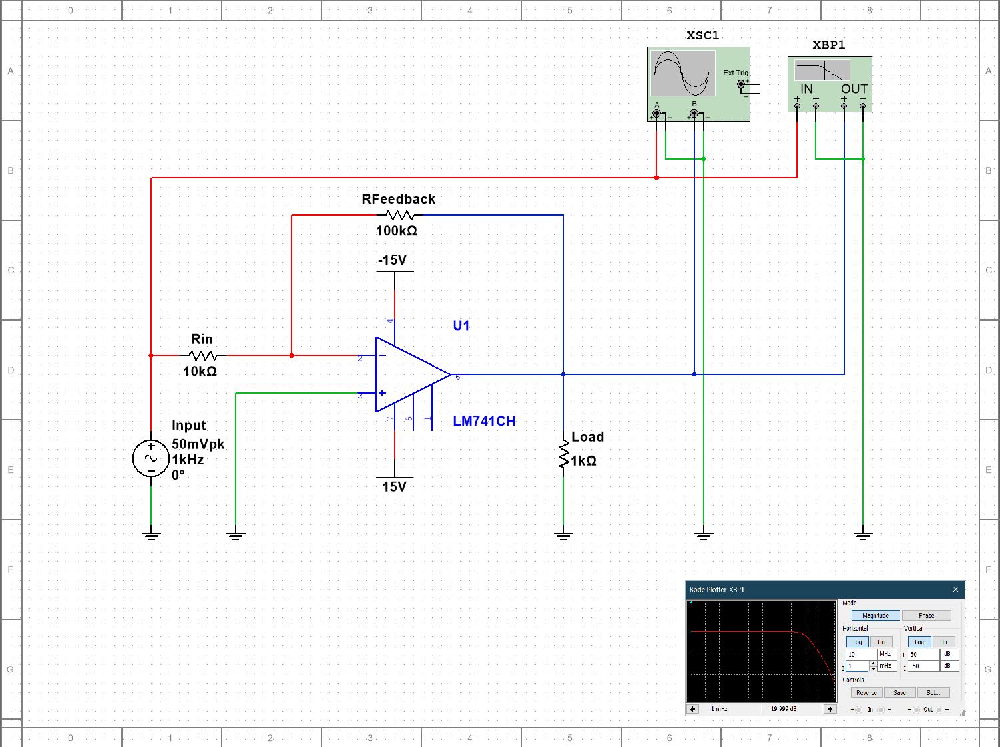
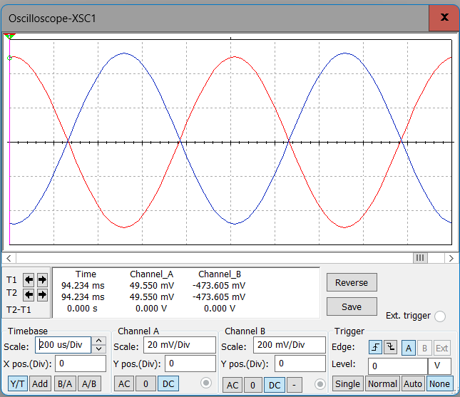

# LM741 Inverting Amplifier

This folder contains the Multisim and CRUMB 3D designs and oscilloscope evidence for an LM741 inverting amplifier.

## Design




The Multisim design uses `Rin = 10 kOhm`, `Rfeedback = 100 kOhm`, a `1 kOhm` load, +/-15 V supplies, and a 50 mV-peak, 1 kHz input. The non-inverting input is grounded; the input signal is applied through `Rin` to the inverting input and negative feedback is returned through `Rfeedback`.

The ideal closed-loop gain is:

```text
Av = -Rfeedback / Rin
   = -100 kOhm / 10 kOhm
   = -10 V/V
|Av| = 10 V/V = 20 dB
```

The minus sign indicates that the output is inverted. For the schematic's 50 mV-peak input, the ideal output is 500 mV peak or 1.00 V peak-to-peak.

## Multisim result



At the displayed cursor position, Multisim reads 49.550 mV on Channel A and -473.605 mV on Channel B at 94.234 ms. The instantaneous ratio is approximately -9.56 V/V, close to the ideal -10 V/V. These are point readings, not peak-to-peak amplitudes. The schematic's Bode plot also shows a midband magnitude close to 20 dB, or 10 V/V.

## Hardware measurements

The hardware images show the Siglent measurement bar. Channel 1 is the yellow input and Channel 2 is the magenta output. The Vpp measurements below are transcribed from the screen; the gain column is recalculated as `Vout(pp) / Vin(pp)`. Frequencies are the filenames. This is the observed hardware ratio, not the schematic's ideal gain.

| Capture frequency | Input (Vpp) | Output (Vpp) | Observed gain magnitude (V/V) | Scope phase (deg) |
|---:|---:|---:|---:|---:|
| 50 Hz | 0.0210 | 2.06 | 98.10 | 181.02 |
| 100 Hz | 0.0212 | 2.02 | 95.28 | 178.12 |
| 200 Hz | 0.0210 | 2.02 | 96.19 | 180.07 |
| 500 Hz | 0.0208 | 1.98 | 95.19 | 180.18 |
| 1 kHz | 0.0206 | 1.96 | 95.15 | 177.71 |
| 2 kHz | 0.0206 | 1.96 | 95.15 | 181.08 |
| 5 kHz | 0.0206 | 2.00 | 97.09 | 185.41 |
| 10 kHz | 0.0214 | 2.08 | 97.20 | 191.82 |
| 50 kHz | 0.0212 | 1.40 | 66.04 | Not shown |
| 100 kHz | 0.0210 | 0.800 | 38.10 | Not shown |
| 200 kHz | 0.0210 | 0.440 | 20.95 | Not shown |
| 500 kHz | 0.0210 | 0.220 | 10.48 | Not shown |
| 2 MHz | 0.0206 | 0.056 | 2.72 | Not shown |
| 5 MHz | 0.0200 | 0.032 | 1.60 | 9.00 |
| 10 MHz | 0.0208 | 0.140 | 6.73 | -50.51 |

At 1 kHz, the hardware screenshot's displayed values give `1.96 Vpp / 20.60 mVpp = 95.15 V/V`, not 10 V/V. This is not a correction to the ideal formula: it indicates that the hardware capture does not match the stated 10 kOhm / 100 kOhm circuit, or that its measurement setup is misconfigured. The input is also only 20.6 mVpp in this capture, whereas the Multisim source is set to 100 mVpp. Confirm the physical resistor values and wiring, probe attenuation, and channel scaling before using the hardware result as validation. The 5 MHz and 10 MHz readings are non-monotonic and their output/phase readings may be unreliable near the noise floor.

No `1MHz.png` capture is present in this folder.

## Hardware oscilloscope captures

The measurement labels are included in each image. The scope's phase values are reproduced as displayed; values may wrap around 360 degrees, and a dash in the table means the capture had no readable phase value.

| 50 Hz | 100 Hz | 200 Hz |
|---|---|---|
|  |  |  |
| 500 Hz | 1 kHz | 2 kHz |
|  |  |  |
| 5 kHz | 10 kHz | 50 kHz |
|  |  |  |
| 100 kHz | 200 kHz | 500 kHz |
|  |  |  |
| 2 MHz | 5 MHz | 10 MHz |
|  |  |  |
