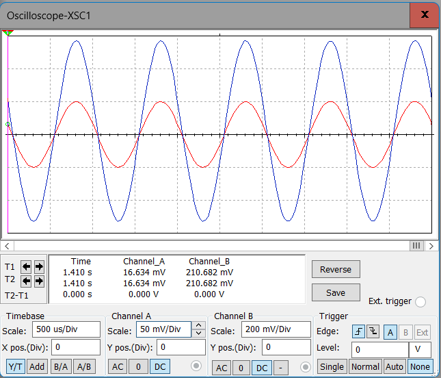

# LM741 Non-Inverting Amplifier

This folder contains the Multisim and CRUMB 3D designs and oscilloscope evidence for an LM741 non-inverting amplifier.

## Design


The Multisim design uses `Rfeedback = 100 kOhm`, a `10 kOhm` resistor from the inverting input to ground, a `1 kOhm` load, +/-15 V supplies, and a 50 mV-peak, 1 kHz input. The signal is applied to the non-inverting input; the resistor divider feeds a fraction of the output back to the inverting input.

The ideal closed-loop gain is:

```text
Av = 1 + Rfeedback / Rground
   = 1 + 100 kOhm / 10 kOhm
   = +11 V/V
Av(dB) = 20 * log10(11) = 20.83 dB
```

The output is in phase with the input in the ideal midband model. For the schematic's 50 mV-peak input, the ideal output is 550 mV peak or 1.10 V peak-to-peak.

## Multisim result



At the displayed cursor position, Multisim reads 16.634 mV on Channel A and 210.682 mV on Channel B at 1.410 s. Their instantaneous ratio is approximately +12.66 V/V, in the vicinity of the ideal +11 V/V. These are point readings, not peak-to-peak amplitudes; use the theoretical resistor-ratio result as the design target.

## Hardware measurements

The hardware images show the Siglent measurement bar. Channel 1 is the yellow input and Channel 2 is the magenta output. The Vpp readings below are transcribed from the screen, and gain is recalculated as `Vout(pp) / Vin(pp)`. Frequencies use the image filenames because some on-screen frequency-counter values do not match their filenames. The ratios are the observed hardware results, not the ideal gain of +11 V/V.

| Capture frequency | Input (Vpp) | Output (Vpp) | Observed gain magnitude (V/V) |
|---:|---:|---:|---:|
| 50 Hz | 0.348 | 2.26 | 6.49 |
| 100 Hz | 0.368 | 2.28 | 6.20 |
| 200 Hz | 0.440 | 2.28 | 5.18 |
| 500 Hz | 0.348 | 2.24 | 6.44 |
| 1 kHz | 0.356 | 2.26 | 6.35 |
| 2 kHz | 0.368 | 2.28 | 6.20 |
| 5 kHz | 0.336 | 2.28 | 6.79 |
| 10 kHz | 0.332 | 2.30 | 6.93 |
| 50 kHz | 0.352 | 1.82 | 5.17 |
| 100 kHz | 0.296 | 1.16 | 3.92 |
| 200 kHz | 0.284 | 0.700 | 2.46 |
| 500 kHz | 0.316 | 0.300 | 0.95 |
| 1 MHz | 0.272 | 0.132 | 0.49 |
| 2 MHz | 0.232 | 0.068 | 0.29 |
| 5 MHz | 0.364 | 0.028 | 0.077 |
| 10 MHz | 0.124 | 0.020 | 0.16 |

At 1 kHz, the hardware screenshot's Vpp readings give `2.26 Vpp / 0.356 Vpp = 6.35 V/V`, not 11 V/V. This is not a correction to the ideal gain formula; the saved hardware capture does not demonstrate the stated circuit's expected gain. The hardware input amplitude also varies substantially across captures, so use the measured input in each row rather than the schematic generator setting. Verify the feedback-divider wiring and resistor values, scope probe attenuation, and channel assignments. The phase values shown on some captures also do not consistently match an in-phase non-inverting response, so treat them as instrument readouts requiring setup verification.

## Hardware oscilloscope captures

The gallery contains all 16 frequency-named captures. The two `SDS` images are included separately because their circuit identity is not clear from the screenshots; they are not included in the non-inverting frequency table.

| 50 Hz | 100 Hz | 200 Hz |
|---|---|---|
|  |  |  |
| 500 Hz | 1 kHz | 2 kHz |
|  |  |  |
| 5 kHz | 10 kHz | 50 kHz |
|  |  |  |
| 100 kHz | 200 kHz | 500 kHz |
|  |  |  |
| 1 MHz | 2 MHz | 5 MHz |
|  |  |  |
| 10 MHz | SDS00016 (scope label: 5 MHz) | SDS00017 (scope label: 10 MHz) |
|  |  |  |

The two supplementary images show these readings, but their circuit assignment is uncertain:

| Image | Scope frequency label | Input (Vpp) | Output (Vpp) | Observed ratio (V/V) | Scope phase (deg) |
|---|---:|---:|---:|---:|---:|
| `SDS00016.png` | 5 MHz | 0.0200 | 0.082 | 4.10 | 9.00 |
| `SDS00017.png` | 10 MHz | 0.0188 | 0.016 | 0.85 | Not measurable |

## Calculation and measurement notes

```text
Av = Vout(pp) / Vin(pp)
Av(dB) = 20 * log10(|Av|)
```

These gain ratios are recalculated from the values printed by the scope; they are not inferred from waveform height. The Multisim cursor readings are instantaneous samples and must not be compared directly with Vpp. For a useful hardware validation, confirm the resistor values and wiring, set a known input, measure both channels with the same probe attenuation convention, and compare the resulting gain with +11 V/V at a frequency well within the LM741's bandwidth.
