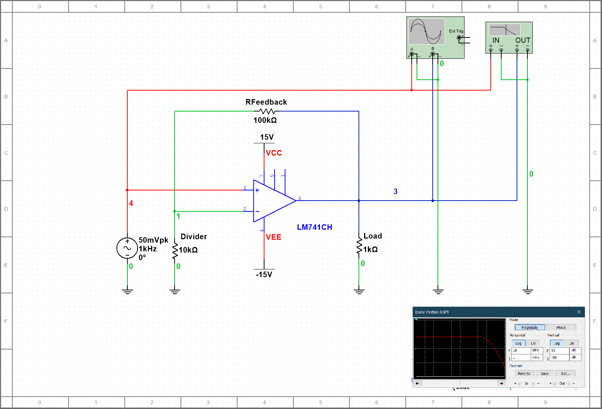

# LM741 Non-Inverting Amplifier

This folder contains the Multisim and CRUMB 3D designs and oscilloscope evidence for an LM741 non-inverting amplifier.

## Design




The Multisim design uses `Rfeedback = 100 kOhm`, a `10 kOhm` resistor from the inverting input to ground, a `1 kOhm` load, +/-15 V supplies, and a 50 mV-peak, 1 kHz input. The signal is applied to the non-inverting input; the resistor divider feeds a fraction of the output back to the inverting input.

The ideal closed-loop gain is:

```text
Av = 1 + Rfeedback / Rground
   = 1 + 100 kOhm / 10 kOhm
   = +11 V/V
Av(dB) = 20 * log10(11) = 20.83 dB
```

The output is in phase with the input in the ideal midband model. For the schematic's 50 mV-peak input, the ideal output is 550 mV peak or 1.10 V peak-to-peak.

## Multisim result


At the displayed cursor position, Multisim reads 16.634 mV on Channel A and 210.682 mV on Channel B at 1.410 s. Their instantaneous ratio is approximately +12.66 V/V, in the vicinity of the ideal +11 V/V. These are point readings, not peak-to-peak amplitudes; use the theoretical resistor-ratio result as the design target.

## Hardware measurements

The replacement hardware images show the Siglent measurement bar. Channel 1 is the yellow input and Channel 2 is the magenta output. The Vpp readings below are transcribed from the screen, and gain is recalculated as `Vout(pp) / Vin(pp)`. Frequencies follow the capture filenames; the scope's frequency-counter readout is noisy and unreliable at high frequencies.

| Capture frequency (filename) | Input (Vpp) | Output (Vpp) | Observed gain magnitude (V/V) |
|---:|---:|---:|---:|
| 100 Hz | 0.224 | 2.260 | 10.09 |
| 200 Hz | 0.220 | 2.260 | 10.27 |
| 500 Hz | 0.220 | 2.260 | 10.27 |
| 1 kHz | 0.220 | 2.260 | 10.27 |
| 2 kHz | 0.216 | 2.240 | 10.37 |
| 5 kHz | 0.216 | 2.240 | 10.37 |
| 10 kHz | 0.220 | 2.260 | 10.27 |
| 50 kHz | 0.212 | 1.800 | 8.49 |
| 100 kHz | 0.212 | 1.180 | 5.57 |
| 200 kHz | 0.216 | 0.660 | 3.06 |
| 500 kHz | 0.204 | 0.272 | 1.33 |
| 1 MHz | 0.208 | 0.136 | 0.65 |
| 2 MHz | 0.204 | 0.072 | 0.35 |
| 5 MHz | 0.188 | 0.036 | 0.19 |
| 10 MHz | 0.152 | 0.0096 | 0.063 |

There is no 50 Hz image in the replacement capture set. From 100 Hz through 10 kHz, the measured gain is 10.09–10.37 V/V, about 6–8% below the ideal +11 V/V. At 1 kHz, `2.260 Vpp / 0.220 Vpp = 10.27 V/V`, confirming the expected non-inverting gain closely. The measured input is about 0.22 Vpp, higher than the schematic's nominal 0.10 Vpp source setting; use the measured Channel 1 value for gain. Gain falls from about 8.49 V/V at 50 kHz as the LM741 approaches its bandwidth limit. For frequency-response interpretation, use the frequencies in the capture filenames; do not use the high-frequency scope-counter readouts, which are unreliable because of noise.

## Hardware oscilloscope captures

The replacement gallery contains 15 captures, from 100 Hz to 10 MHz. No 50 Hz capture is present.

| 100 Hz | 200 Hz | 500 Hz |
|---|---|---|
|  |  |  |
| 1 kHz | 2 kHz | 5 kHz |
|  |  |  |
| 10 kHz | 50 kHz | 100 kHz |
|  |  |  |
| 200 kHz | 500 kHz | 1 MHz |
|  |  |  |
| 2 MHz | 5 MHz | 10 MHz |
|  |  |  |

## Calculation and measurement notes

```text
Av = Vout(pp) / Vin(pp)
Av(dB) = 20 * log10(|Av|)
```

These gain ratios are recalculated from the values printed by the scope; they are not inferred from waveform height. The Multisim cursor readings are instantaneous samples and must not be compared directly with Vpp. For a useful hardware validation, confirm the resistor values and wiring, set a known input, measure both channels with the same probe attenuation convention, and compare the resulting gain with +11 V/V at a frequency well within the LM741's bandwidth.
