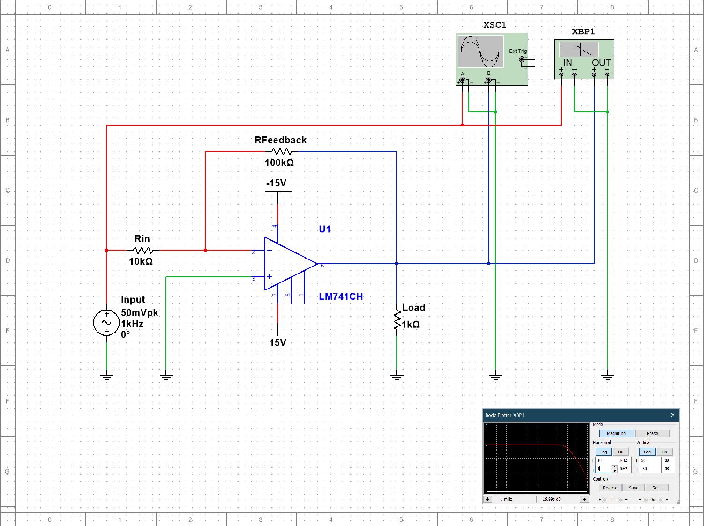
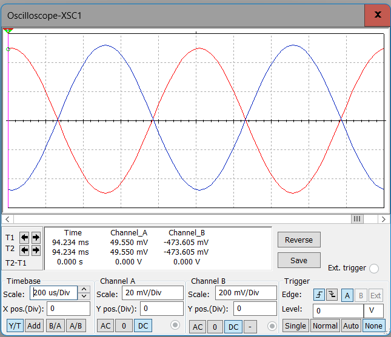
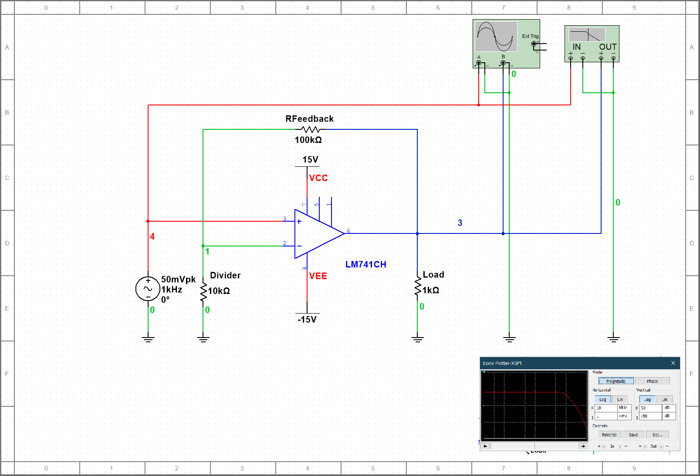
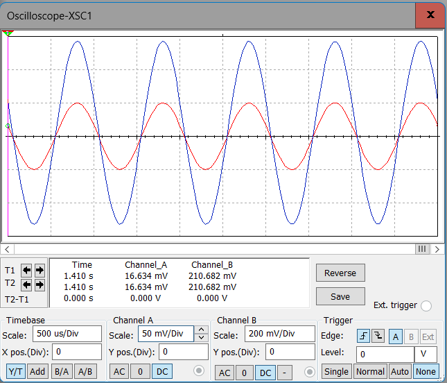

# LM741 Inverting and Non-Inverting Amplifiers

This folder documents two LM741 op-amp configurations built and tested in Multisim and the CRUMB 3D breadboard simulator. Each circuit uses +/-15 V supplies and a 1 kOhm output load. The stored hardware oscilloscope captures provide peak-to-peak input/output readings over a range of frequencies.

## Project files

- [Inverting/](Inverting/) - inverting amplifier Multisim, CRUMB, schematic, scope screenshot, and hardware frequency captures.
- [Non-Inverting/](Non-Inverting/) - non-inverting amplifier Multisim, CRUMB, schematic, scope screenshot, and hardware frequency captures.
- `Inverting Opamp.ms14` and `Non-Inverting Opamp.ms14` - top-level Multisim copies.
- The `*.ms14 (Security copy)` files are Multisim backup copies.

## Circuit principles and expected gain

For the inverting circuit, the non-inverting input is grounded and the input signal reaches the inverting input through `Rin`. Negative feedback through `Rfeedback` gives an ideal closed-loop voltage gain of:

```text
Av = -Rfeedback / Rin
   = -100 kOhm / 10 kOhm
   = -10 V/V (20 dB)
```

The negative sign denotes phase inversion. For the non-inverting circuit, the input is applied to the non-inverting input and the feedback divider sets the gain:

```text
Av = 1 + Rfeedback / Rground
   = 1 + 100 kOhm / 10 kOhm
   = +11 V/V (20.83 dB)
```

These are ideal midband calculations. The LM741 has finite gain-bandwidth, slew rate, output swing, and input/output limitations; high-frequency and large-amplitude results will differ from the ideal equations.

## Inverting amplifier






The schematic uses `Rin = 10 kOhm`, `Rfeedback = 100 kOhm`, a `1 kOhm` load, +/-15 V supplies, and a 50 mV-peak, 1 kHz input. The ideal output is 500 mV peak (1.00 V peak-to-peak), inverted.

### Hardware measurements

The values below are transcribed from the Siglent screenshot measurement bar. The scope labels Channel 1 as input and Channel 2 as output. Gain is calculated from the displayed peak-to-peak readings; the phase column is the scope's own `Phase[1-2]` reading, included as displayed. Frequencies are the capture filenames. A missing phase means the image did not provide a readable phase value.

| Capture frequency | Input (Vpp) | Output (Vpp) | Measured gain (V/V) | Gain (dB) | Scope phase (deg) |
|---:|---:|---:|---:|---:|---:|
| 50 Hz | 0.0210 | 2.06 | 98.10 | 39.83 | 181.02 |
| 100 Hz | 0.0212 | 2.02 | 95.28 | 39.58 | 178.12 |
| 200 Hz | 0.0210 | 2.02 | 96.19 | 39.66 | 180.07 |
| 500 Hz | 0.0208 | 1.98 | 95.19 | 39.57 | 180.18 |
| 1 kHz | 0.0206 | 1.96 | 95.15 | 39.57 | 177.71 |
| 2 kHz | 0.0206 | 1.96 | 95.15 | 39.57 | 181.08 |
| 5 kHz | 0.0206 | 2.00 | 97.09 | 39.74 | 185.41 |
| 10 kHz | 0.0214 | 2.08 | 97.20 | 39.75 | 191.82 |
| 50 kHz | 0.0212 | 1.40 | 66.04 | 36.40 | - |
| 100 kHz | 0.0210 | 0.800 | 38.10 | 31.62 | - |
| 200 kHz | 0.0210 | 0.440 | 20.95 | 26.42 | - |
| 500 kHz | 0.0210 | 0.220 | 10.48 | 20.40 | - |
| 2 MHz | 0.0206 | 0.056 | 2.72 | 8.69 | - |
| 5 MHz | 0.0200 | 0.032 | 1.60 | 4.08 | 9.00 |
| 10 MHz | 0.0208 | 0.140 | 6.73 | 16.56 | -50.51 |

The 1 kHz hardware gain from the displayed readings is approximately 95 V/V, about 9.5 times the ideal gain calculated from the schematic. The output drops at higher frequencies, but the 5 MHz and 10 MHz readings are not monotonic and the displayed phase values become implausible as the output approaches the noise floor. Check the physical input resistor value, feedback wiring, probe attenuation/settings, and scope channel assignments before treating these captures as validation of the 10 kOhm / 100 kOhm design.

The folder has no `1MHz.png` capture for this circuit.

### Hardware scope gallery

<details>
<summary>Show inverting amplifier captures</summary>

| 50 Hz | 100 Hz | 200 Hz |
|---|---|---|
|  |  |  |
| 500 Hz | 1 kHz | 2 kHz |
|  |  |  |
| 5 kHz | 10 kHz | 50 kHz |
|  |  |  |
| 100 kHz | 200 kHz | 500 kHz |
|  |  |  |
| 2 MHz | 5 MHz | 10 MHz |
|  |  |  |

</details>

## Non-inverting amplifier






The schematic uses `Rfeedback = 100 kOhm`, a `10 kOhm` resistor from the inverting input to ground, a `1 kOhm` load, +/-15 V supplies, and a 50 mV-peak, 1 kHz input. The ideal output is 550 mV peak (1.10 V peak-to-peak), in phase with the input.

### Hardware measurements

As above, the input and output are the scope's Channel 1 and Channel 2 peak-to-peak readings. The gain and dB columns are calculated from those measurements. Phase values are shown exactly as reported by the oscilloscope, not adjusted to match the ideal circuit. Frequencies use the image filenames because some screenshots' instrument frequency counters do not agree with the filenames.

| Capture frequency | Input (Vpp) | Output (Vpp) | Measured gain (V/V) | Gain (dB) | Scope phase (deg) |
|---:|---:|---:|---:|---:|---:|
| 50 Hz | 0.348 | 2.26 | 6.49 | 16.25 | 26.94 |
| 100 Hz | 0.368 | 2.28 | 6.20 | 15.84 | - |
| 200 Hz | 0.440 | 2.28 | 5.18 | 14.29 | 172.11 |
| 500 Hz | 0.348 | 2.24 | 6.44 | 16.17 | - |
| 1 kHz | 0.356 | 2.26 | 6.35 | 16.05 | 116.61 |
| 2 kHz | 0.368 | 2.28 | 6.20 | 15.84 | - |
| 5 kHz | 0.336 | 2.28 | 6.79 | 16.63 | 126.21 |
| 10 kHz | 0.332 | 2.30 | 6.93 | 16.81 | 8.69 |
| 50 kHz | 0.352 | 1.82 | 5.17 | 14.27 | 35.38 |
| 100 kHz | 0.296 | 1.16 | 3.92 | 11.86 | - |
| 200 kHz | 0.284 | 0.700 | 2.46 | 7.84 | 82.28 |
| 500 kHz | 0.316 | 0.300 | 0.95 | -0.45 | - |
| 1 MHz | 0.272 | 0.132 | 0.49 | -6.28 | - |
| 2 MHz | 0.232 | 0.068 | 0.29 | -10.66 | 126.84 |
| 5 MHz | 0.364 | 0.028 | 0.077 | -22.28 | 172.15 |
| 10 MHz | 0.124 | 0.020 | 0.16 | -15.85 | - |

Near 1 kHz, the measured hardware gain is approximately 6.35 V/V, below the ideal 11 V/V. The scope phase readings in several low- and mid-frequency captures are inconsistent with the expected near-zero phase of a non-inverting amplifier. Treat these as raw instrument readings and recheck probe/channel assignments, wiring, and the frequency counter settings. Above several hundred kilohertz, the output becomes smaller than the input, consistent with the LM741's limited bandwidth; very small output readings are also increasingly sensitive to noise and measurement resolution.

The two extra files `SDS00016.png` and `SDS00017.png` are stored in this folder but are not clearly identified with either circuit in the screenshots. Their displayed input amplitudes resemble the inverting capture set more than the numbered non-inverting captures, so they are reported separately and are not included in the non-inverting results above.

| Supplementary image | Scope frequency | Input (Vpp) | Output (Vpp) | Gain (V/V) | Gain (dB) | Scope phase (deg) |
|---|---:|---:|---:|---:|---:|---:|
| `SDS00016.png` | 5 MHz | 0.0200 | 0.082 | 4.10 | 12.26 | 9.00 |
| `SDS00017.png` | 10 MHz | 0.0188 | 0.016 | 0.85 | -1.40 | Not measurable |

### Hardware scope gallery

<details>
<summary>Show non-inverting amplifier captures</summary>

| 50 Hz | 100 Hz | 200 Hz |
|---|---|---|
|  |  |  |
| 500 Hz | 1 kHz | 2 kHz |
|  |  |  |
| 5 kHz | 10 kHz | 50 kHz |
|  |  |  |
| 100 kHz | 200 kHz | 500 kHz |
|  |  |  |
| 1 MHz | 2 MHz | 5 MHz |
|  |  |  |
| 10 MHz | Extra capture SDS00016 | Extra capture SDS00017 |
|  |  |  |

</details>

## Calculation method and measurement notes

For each capture, the gain calculations are:

```text
Av = Vout(pp) / Vin(pp)
Av(dB) = 20 * log10(|Av|)
```

Using peak-to-peak values avoids mixing peak, RMS, and peak-to-peak conventions. The instrument phase column is transcribed from the screen and may wrap around 360 degrees. A dash means no readable value was present. Values near the oscilloscope noise floor, captures with waveform fuzz, and captures whose filename does not agree with the instrument's frequency counter should not be used to claim precise bandwidth or phase margins.

The Multisim `Oscilloscope.png` files show cursor samples, not peak-to-peak measurements. For the inverting screenshot, the cursor reads 49.550 mV on Channel A and -473.605 mV on Channel B at 94.234 ms. For the non-inverting screenshot, it reads 16.634 mV and 210.682 mV at 1.410 s. These instantaneous cursor values are not interchangeable with the hardware table's Vpp readings.

## Further checks

1. Confirm the physical resistor values and feedback topology against each schematic, especially the inverting input resistor where the measured gain is far above the expected value.
2. Verify scope probe attenuation and that Channel 1 is connected to the input while Channel 2 is connected to the output.
3. Re-run each circuit at 1 kHz with the same known input amplitude, then compare measured Vpp gain and phase with the expected -10 V/V and +11 V/V.
4. Use only frequencies whose actual source frequency has been confirmed; the screenshot filenames and on-screen frequency counters disagree in some captures.
5. For bandwidth measurements, reduce the input amplitude as needed, use a consistent load, and take more closely spaced measurements around the -3 dB points.
